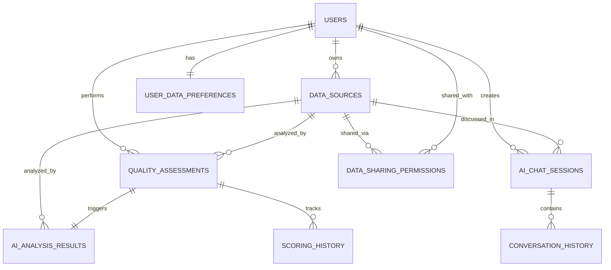

# 数据管理功能 - 数据库设计

## 🗄️ 数据库架构概览

基于现有PostgreSQL云数据库(47.79.87.199:5432)，设计支持数据质量分析、AI对话和用户管理的完整数据模型。采用多数据库分离策略，确保性能和可扩展性。

## 📊 数据库分布策略

### 数据库分配方案

**主数据库 (saascontrol_dev_pro1)**:
- 核心业务数据
- 用户和权限管理
- 数据源和质量评估
- 实时操作数据

**扩展数据库 (saascontrol_dev_pro2)**:
- AI分析结果
- 对话历史存储
- 长期归档数据
- 分析报告缓存

### 跨库关联策略

```sql
-- 跨数据库关联通过应用层实现
-- 使用统一ID规范: UUID格式
-- 主键关联: user_id, data_source_id, analysis_id
```

## 🏗️ 核心数据表设计

### 1. 数据源管理表 (主数据库)

#### data_sources - 数据源主表
```sql
CREATE TABLE data_sources (
    id UUID PRIMARY KEY DEFAULT gen_random_uuid(),
    user_id UUID NOT NULL REFERENCES users(id) ON DELETE CASCADE,
    name VARCHAR(255) NOT NULL,
    description TEXT,
    file_path TEXT NOT NULL,
    file_size BIGINT NOT NULL,
    file_type VARCHAR(50) NOT NULL, -- 'csv', 'excel', 'json', 'parquet'
    row_count INTEGER,
    column_count INTEGER,
    upload_status VARCHAR(20) DEFAULT 'pending', -- 'pending', 'processing', 'completed', 'failed'
    processing_progress INTEGER DEFAULT 0, -- 0-100
    metadata JSONB, -- 文件元数据和统计信息
    created_at TIMESTAMP WITH TIME ZONE DEFAULT NOW(),
    updated_at TIMESTAMP WITH TIME ZONE DEFAULT NOW(),
    processed_at TIMESTAMP WITH TIME ZONE,

    -- 索引
    CONSTRAINT valid_file_type CHECK (file_type IN ('csv', 'excel', 'json', 'parquet')),
    CONSTRAINT valid_upload_status CHECK (upload_status IN ('pending', 'processing', 'completed', 'failed')),
    CONSTRAINT valid_progress CHECK (processing_progress >= 0 AND processing_progress <= 100)
);

-- 索引优化
CREATE INDEX idx_data_sources_user_id ON data_sources(user_id);
CREATE INDEX idx_data_sources_upload_status ON data_sources(upload_status);
CREATE INDEX idx_data_sources_created_at ON data_sources(created_at DESC);
CREATE INDEX idx_data_sources_file_type ON data_sources(file_type);

-- 复合索引
CREATE INDEX idx_data_sources_user_status ON data_sources(user_id, upload_status);
```

#### quality_assessments - 质量评估记录表
```sql
CREATE TABLE quality_assessments (
    id UUID PRIMARY KEY DEFAULT gen_random_uuid(),
    data_source_id UUID NOT NULL REFERENCES data_sources(id) ON DELETE CASCADE,
    user_id UUID NOT NULL REFERENCES users(id) ON DELETE CASCADE,

    -- 4维度质量评分 (0-100)
    completeness_score DECIMAL(5,2) CHECK (completeness_score >= 0 AND completeness_score <= 100),
    consistency_score DECIMAL(5,2) CHECK (consistency_score >= 0 AND consistency_score <= 100),
    accuracy_score DECIMAL(5,2) CHECK (accuracy_score >= 0 AND accuracy_score <= 100),
    timeliness_score DECIMAL(5,2) CHECK (timeliness_score >= 0 AND timeliness_score <= 100),

    -- 综合评分
    overall_score DECIMAL(5,2) CHECK (overall_score >= 0 AND overall_score <= 100),
    quality_grade VARCHAR(1) CHECK (quality_grade IN ('A', 'B', 'C', 'D', 'F')),

    -- 详细分析结果
    dimension_details JSONB NOT NULL, -- 每个维度的详细分析结果
    improvement_suggestions JSONB, -- 质量改进建议

    -- 分析状态
    analysis_status VARCHAR(20) DEFAULT 'pending', -- 'pending', 'running', 'completed', 'failed'
    analysis_duration INTEGER, -- 分析耗时(秒)
    error_message TEXT, -- 错误信息

    -- 时间戳
    created_at TIMESTAMP WITH TIME ZONE DEFAULT NOW(),
    completed_at TIMESTAMP WITH TIME ZONE,

    CONSTRAINT valid_analysis_status CHECK (analysis_status IN ('pending', 'running', 'completed', 'failed'))
);

-- 索引优化
CREATE INDEX idx_quality_assessments_data_source_id ON quality_assessments(data_source_id);
CREATE INDEX idx_quality_assessments_user_id ON quality_assessments(user_id);
CREATE INDEX idx_quality_assessments_status ON quality_assessments(analysis_status);
CREATE INDEX idx_quality_assessments_overall_score ON quality_assessments(overall_score DESC);
CREATE INDEX idx_quality_assessments_created_at ON quality_assessments(created_at DESC);

-- 复合索引
CREATE INDEX idx_quality_assessments_user_status ON quality_assessments(user_id, analysis_status);
CREATE INDEX idx_quality_assessments_source_score ON quality_assessments(data_source_id, overall_score DESC);
```

#### scoring_history - 评分历史表
```sql
CREATE TABLE scoring_history (
    id UUID PRIMARY KEY DEFAULT gen_random_uuid(),
    data_source_id UUID NOT NULL REFERENCES data_sources(id) ON DELETE CASCADE,
    assessment_id UUID NOT NULL REFERENCES quality_assessments(id) ON DELETE CASCADE,
    user_id UUID NOT NULL REFERENCES users(id) ON DELETE CASCADE,

    -- 历史评分快照
    score_snapshot JSONB NOT NULL, -- 完整的评分数据快照
    score_change DECIMAL(5,2), -- 与上一次评分的变化
    trend_direction VARCHAR(10) CHECK (trend_direction IN ('up', 'down', 'stable', 'first')),

    -- 变更原因
    change_reason VARCHAR(100), -- 'data_update', 'algorithm_update', 'manual_rerun'
    change_description TEXT,

    created_at TIMESTAMP WITH TIME ZONE DEFAULT NOW(),

    CONSTRAINT valid_trend_direction CHECK (trend_direction IN ('up', 'down', 'stable', 'first')),
    CONSTRAINT valid_change_reason CHECK (change_reason IN ('data_update', 'algorithm_update', 'manual_rerun'))
);

-- 索引优化
CREATE INDEX idx_scoring_history_data_source_id ON scoring_history(data_source_id);
CREATE INDEX idx_scoring_history_assessment_id ON scoring_history(assessment_id);
CREATE INDEX idx_scoring_history_user_id ON scoring_history(user_id);
CREATE INDEX idx_scoring_history_created_at ON scoring_history(created_at DESC);

-- 复合索引
CREATE INDEX idx_scoring_history_source_time ON scoring_history(data_source_id, created_at DESC);
```

### 2. AI分析和对话表 (扩展数据库)

#### ai_analysis_results - AI分析结果表
```sql
CREATE TABLE ai_analysis_results (
    id UUID PRIMARY KEY DEFAULT gen_random_uuid(),
    data_source_id UUID NOT NULL, -- 关联主数据库中的data_sources.id
    quality_assessment_id UUID NOT NULL, -- 关联主数据库中的quality_assessments.id
    user_id UUID NOT NULL, -- 关联主数据库中的users.id

    -- AI分析结果
    ai_insights JSONB NOT NULL, -- AI生成的洞察分析
    recommendations JSONB NOT NULL, -- AI推荐的改进措施
    anomaly_detection JSONB, -- 异常检测结果
    pattern_analysis JSONB, -- 模式分析结果

    -- AI模型信息
    model_name VARCHAR(100) NOT NULL DEFAULT 'gpt-3.5-turbo',
    model_version VARCHAR(50),
    prompt_tokens INTEGER,
    completion_tokens INTEGER,
    total_tokens INTEGER,

    -- 分析状态
    analysis_status VARCHAR(20) DEFAULT 'pending', -- 'pending', 'running', 'completed', 'failed'
    analysis_duration INTEGER, -- AI分析耗时(秒)
    confidence_score DECIMAL(5,2) CHECK (confidence_score >= 0 AND confidence_score <= 100),

    -- 时间戳
    created_at TIMESTAMP WITH TIME ZONE DEFAULT NOW(),
    completed_at TIMESTAMP WITH TIME ZONE,

    CONSTRAINT valid_analysis_status CHECK (analysis_status IN ('pending', 'running', 'completed', 'failed'))
);

-- 索引优化
CREATE INDEX idx_ai_analysis_data_source_id ON ai_analysis_results(data_source_id);
CREATE INDEX idx_ai_analysis_assessment_id ON ai_analysis_results(quality_assessment_id);
CREATE INDEX idx_ai_analysis_user_id ON ai_analysis_results(user_id);
CREATE INDEX idx_ai_analysis_status ON ai_analysis_results(analysis_status);
CREATE INDEX idx_ai_analysis_confidence ON ai_analysis_results(confidence_score DESC);
CREATE INDEX idx_ai_analysis_created_at ON ai_analysis_results(created_at DESC);

-- 复合索引
CREATE INDEX idx_ai_analysis_user_status ON ai_analysis_results(user_id, analysis_status);
```

#### ai_chat_sessions - AI对话会话表
```sql
CREATE TABLE ai_chat_sessions (
    id UUID PRIMARY KEY DEFAULT gen_random_uuid(),
    user_id UUID NOT NULL, -- 关联主数据库中的users.id
    data_source_id UUID, -- 可选，关联特定数据源的对话
    analysis_id UUID, -- 可选，关联特定分析结果的对话

    -- 会话信息
    session_title VARCHAR(255) NOT NULL DEFAULT 'AI数据分析对话',
    session_type VARCHAR(20) NOT NULL DEFAULT 'general', -- 'general', 'analysis_specific', 'quality_focused'

    -- 会话状态
    status VARCHAR(20) DEFAULT 'active', -- 'active', 'paused', 'completed', 'expired'
    message_count INTEGER DEFAULT 0,
    total_tokens INTEGER DEFAULT 0,

    -- 上下文管理
    context_summary JSONB, -- 会话上下文摘要
    last_activity_at TIMESTAMP WITH TIME ZONE DEFAULT NOW(),

    -- 时间戳
    created_at TIMESTAMP WITH TIME ZONE DEFAULT NOW(),
    expires_at TIMESTAMP WITH TIME ZONE DEFAULT (NOW() + INTERVAL '24 hours'),

    CONSTRAINT valid_session_type CHECK (session_type IN ('general', 'analysis_specific', 'quality_focused')),
    CONSTRAINT valid_status CHECK (status IN ('active', 'paused', 'completed', 'expired'))
);

-- 索引优化
CREATE INDEX idx_ai_chat_sessions_user_id ON ai_chat_sessions(user_id);
CREATE INDEX idx_ai_chat_sessions_data_source_id ON ai_chat_sessions(data_source_id);
CREATE INDEX idx_ai_chat_sessions_status ON ai_chat_sessions(status);
CREATE INDEX idx_ai_chat_sessions_last_activity ON ai_chat_sessions(last_activity_at DESC);

-- 复合索引
CREATE INDEX idx_ai_chat_sessions_user_status ON ai_chat_sessions(user_id, status);
```

#### conversation_history - 对话历史表
```sql
CREATE TABLE conversation_history (
    id UUID PRIMARY KEY DEFAULT gen_random_uuid(),
    session_id UUID NOT NULL REFERENCES ai_chat_sessions(id) ON DELETE CASCADE,
    user_id UUID NOT NULL, -- 关联主数据库中的users.id

    -- 消息内容
    message_type VARCHAR(20) NOT NULL, -- 'user', 'assistant', 'system'
    message_content TEXT NOT NULL,
    message_metadata JSONB, -- 消息元数据(图片、文件等)

    -- AI响应信息
    ai_model VARCHAR(100), -- 仅assistant消息
    prompt_tokens INTEGER, -- 仅assistant消息
    completion_tokens INTEGER, -- 仅assistant消息
    response_time INTEGER, -- AI响应时间(毫秒)

    -- 消息状态
    is_visible BOOLEAN DEFAULT TRUE, -- 是否对用户可见
    is_flagged BOOLEAN DEFAULT FALSE, -- 是否被标记(安全/质量问题)

    created_at TIMESTAMP WITH TIME ZONE DEFAULT NOW(),

    CONSTRAINT valid_message_type CHECK (message_type IN ('user', 'assistant', 'system'))
);

-- 索引优化
CREATE INDEX idx_conversation_history_session_id ON conversation_history(session_id);
CREATE INDEX idx_conversation_history_user_id ON conversation_history(user_id);
CREATE INDEX idx_conversation_history_created_at ON conversation_history(created_at DESC);
CREATE INDEX idx_conversation_history_message_type ON conversation_history(message_type);

-- 复合索引
CREATE INDEX idx_conversation_history_session_time ON conversation_history(session_id, created_at DESC);
CREATE INDEX idx_conversation_history_user_visible ON conversation_history(user_id, is_visible);
```

### 3. 用户和权限扩展表 (主数据库)

#### user_data_preferences - 用户数据偏好设置表
```sql
CREATE TABLE user_data_preferences (
    id UUID PRIMARY KEY DEFAULT gen_random_uuid(),
    user_id UUID NOT NULL REFERENCES users(id) ON DELETE CASCADE UNIQUE,

    -- 质量分析偏好
    preferred_quality_dimensions JSONB DEFAULT '["completeness", "consistency", "accuracy", "timeliness"]',
    quality_thresholds JSONB DEFAULT '{"excellent": 90, "good": 75, "fair": 60, "poor": 0}',

    -- AI对话偏好
    ai_interaction_style VARCHAR(20) DEFAULT 'balanced', -- 'concise', 'balanced', 'detailed'
    preferred_ai_language VARCHAR(10) DEFAULT 'zh-CN',
    auto_generate_insights BOOLEAN DEFAULT TRUE,

    -- 通知偏好
    email_notifications BOOLEAN DEFAULT TRUE,
    analysis_completion_notifications BOOLEAN DEFAULT TRUE,
    quality_threshold_alerts BOOLEAN DEFAULT TRUE,

    -- 数据导出偏好
    default_export_format VARCHAR(20) DEFAULT 'excel', -- 'csv', 'excel', 'json', 'pdf'
    include_ai_insights_in_export BOOLEAN DEFAULT TRUE,

    created_at TIMESTAMP WITH TIME ZONE DEFAULT NOW(),
    updated_at TIMESTAMP WITH TIME ZONE DEFAULT NOW(),

    CONSTRAINT valid_ai_interaction_style CHECK (ai_interaction_style IN ('concise', 'balanced', 'detailed')),
    CONSTRAINT valid_export_format CHECK (default_export_format IN ('csv', 'excel', 'json', 'pdf'))
);

-- 索引优化
CREATE INDEX idx_user_data_preferences_user_id ON user_data_preferences(user_id);
```

#### data_sharing_permissions - 数据共享权限表
```sql
CREATE TABLE data_sharing_permissions (
    id UUID PRIMARY KEY DEFAULT gen_random_uuid(),
    data_source_id UUID NOT NULL REFERENCES data_sources(id) ON DELETE CASCADE,
    owner_id UUID NOT NULL REFERENCES users(id) ON DELETE CASCADE,
    shared_with_user_id UUID NOT NULL REFERENCES users(id) ON DELETE CASCADE,

    -- 权限控制
    permission_level VARCHAR(20) NOT NULL DEFAULT 'view', -- 'view', 'analyze', 'edit', 'admin'
    can_view_raw_data BOOLEAN DEFAULT TRUE,
    can_run_analysis BOOLEAN DEFAULT FALSE,
    can_export_data BOOLEAN DEFAULT FALSE,
    can_share_with_others BOOLEAN DEFAULT FALSE,

    -- 共享设置
    expires_at TIMESTAMP WITH TIME ZONE,
    is_active BOOLEAN DEFAULT TRUE,
    sharing_message TEXT,

    created_at TIMESTAMP WITH TIME ZONE DEFAULT NOW(),
    updated_at TIMESTAMP WITH TIME ZONE DEFAULT NOW(),

    CONSTRAINT valid_permission_level CHECK (permission_level IN ('view', 'analyze', 'edit', 'admin')),
    CONSTRAINT no_self_sharing CHECK (owner_id != shared_with_user_id)
);

-- 索引优化
CREATE INDEX idx_data_sharing_data_source_id ON data_sharing_permissions(data_source_id);
CREATE INDEX idx_data_sharing_owner_id ON data_sharing_permissions(owner_id);
CREATE INDEX idx_data_sharing_shared_with ON data_sharing_permissions(shared_with_user_id);
CREATE INDEX idx_data_sharing_permission_level ON data_sharing_permissions(permission_level);

-- 复合索引
CREATE INDEX idx_data_sharing_user_active ON data_sharing_permissions(shared_with_user_id, is_active);

-- 唯一约束
CREATE UNIQUE INDEX idx_data_sharing_unique ON data_sharing_permissions(data_source_id, shared_with_user_id);
```

## 🔄 数据关系图

### 主要实体关系



## 📈 索引优化策略

### 查询性能优化

#### 高频查询索引
```sql
-- 用户数据源查询 (首页仪表板)
CREATE INDEX idx_data_sources_user_recent ON data_sources(user_id, created_at DESC)
WHERE upload_status = 'completed';

-- 质量评分排序查询
CREATE INDEX idx_quality_recent_scores ON quality_assessments(user_id, overall_score DESC, created_at DESC)
WHERE analysis_status = 'completed';

-- AI对话活跃会话查询
CREATE INDEX idx_ai_chat_active ON ai_chat_sessions(user_id, last_activity_at DESC)
WHERE status = 'active';

-- 对话历史分页查询
CREATE INDEX idx_conversation_paging ON conversation_history(session_id, created_at DESC)
WHERE is_visible = TRUE;
```

#### 分析类查询索引
```sql
-- 数据质量趋势分析
CREATE INDEX idx_scoring_trend_analysis ON scoring_history(data_source_id, created_at DESC);

-- AI分析结果查询
CREATE INDEX idx_ai_analysis_lookup ON ai_analysis_results(data_source_id, quality_assessment_id)
WHERE analysis_status = 'completed';

-- 用户权限检查
CREATE INDEX idx_sharing_permission_check ON data_sharing_permissions(data_source_id, shared_with_user_id)
WHERE is_active = TRUE AND (expires_at IS NULL OR expires_at > NOW());
```

## 🗄️ 数据分区策略

### 时间分区表设计

#### conversation_history 时间分区
```sql
-- 按月分区对话历史表
CREATE TABLE conversation_history_y2024m09 PARTITION OF conversation_history
FOR VALUES FROM ('2024-09-01') TO ('2024-10-01');

CREATE TABLE conversation_history_y2024m10 PARTITION OF conversation_history
FOR VALUES FROM ('2024-10-01') TO ('2024-11-01');

-- 自动分区管理函数
CREATE OR REPLACE FUNCTION create_monthly_partition(table_name text, start_date date)
RETURNS void AS $$
DECLARE
    partition_name text;
    end_date date;
BEGIN
    partition_name := table_name || '_y' || EXTRACT(YEAR FROM start_date) || 'm' ||
                     LPAD(EXTRACT(MONTH FROM start_date)::text, 2, '0');
    end_date := start_date + INTERVAL '1 month';

    EXECUTE format('CREATE TABLE %I PARTITION OF %I FOR VALUES FROM (%L) TO (%L)',
                  partition_name, table_name, start_date, end_date);
END;
$$ LANGUAGE plpgsql;
```

## 🔒 数据安全策略

### 行级安全策略 (RLS)

#### 数据源访问控制
```sql
-- 启用行级安全
ALTER TABLE data_sources ENABLE ROW LEVEL SECURITY;

-- 用户只能访问自己的数据源或被共享的数据源
CREATE POLICY data_sources_access_policy ON data_sources
    FOR ALL TO authenticated_users
    USING (
        user_id = current_user_id() OR
        id IN (
            SELECT data_source_id
            FROM data_sharing_permissions
            WHERE shared_with_user_id = current_user_id()
              AND is_active = TRUE
              AND (expires_at IS NULL OR expires_at > NOW())
        )
    );
```

#### 质量评估访问控制
```sql
ALTER TABLE quality_assessments ENABLE ROW LEVEL SECURITY;

CREATE POLICY quality_assessments_access_policy ON quality_assessments
    FOR ALL TO authenticated_users
    USING (
        user_id = current_user_id() OR
        data_source_id IN (
            SELECT data_source_id
            FROM data_sharing_permissions
            WHERE shared_with_user_id = current_user_id()
              AND can_run_analysis = TRUE
              AND is_active = TRUE
        )
    );
```

### 敏感数据加密

#### 数据库级加密
```sql
-- 敏感字段加密存储
CREATE EXTENSION IF NOT EXISTS pgcrypto;

-- 加密用户偏好设置
CREATE OR REPLACE FUNCTION encrypt_user_preferences(data jsonb)
RETURNS bytea AS $$
BEGIN
    RETURN pgp_sym_encrypt(data::text, current_setting('app.encryption_key'));
END;
$$ LANGUAGE plpgsql;

-- 解密用户偏好设置
CREATE OR REPLACE FUNCTION decrypt_user_preferences(encrypted_data bytea)
RETURNS jsonb AS $$
BEGIN
    RETURN pgp_sym_decrypt(encrypted_data, current_setting('app.encryption_key'))::jsonb;
END;
$$ LANGUAGE plpgsql;
```

## 📊 数据备份和恢复策略

### 自动备份配置

#### 增量备份策略
```sql
-- 每日增量备份脚本
#!/bin/bash
BACKUP_DIR="/backup/postgresql/incremental"
TIMESTAMP=$(date +%Y%m%d_%H%M%S)

# 主数据库备份
pg_dump -h 47.79.87.199 -p 5432 -U saascontrol_dev_user \
        -d saascontrol_dev_pro1 \
        --format=custom \
        --compress=9 \
        --file="${BACKUP_DIR}/saascontrol_pro1_${TIMESTAMP}.backup"

# 扩展数据库备份
pg_dump -h 47.79.87.199 -p 5432 -U saascontrol_dev_user \
        -d saascontrol_dev_pro2 \
        --format=custom \
        --compress=9 \
        --file="${BACKUP_DIR}/saascontrol_pro2_${TIMESTAMP}.backup"
```

#### 数据恢复脚本
```sql
-- 数据恢复函数
CREATE OR REPLACE FUNCTION restore_data_source_backup(backup_file text)
RETURNS boolean AS $$
BEGIN
    -- 1. 验证备份文件完整性
    -- 2. 创建临时恢复表
    -- 3. 执行数据恢复
    -- 4. 验证数据一致性
    -- 5. 切换到恢复数据
    RETURN TRUE;
EXCEPTION
    WHEN OTHERS THEN
        RAISE NOTICE 'Restore failed: %', SQLERRM;
        RETURN FALSE;
END;
$$ LANGUAGE plpgsql;
```

这个数据库设计为数据管理功能提供了完整、高效的数据存储和访问解决方案，支持高性能查询、数据安全和可扩展性要求。