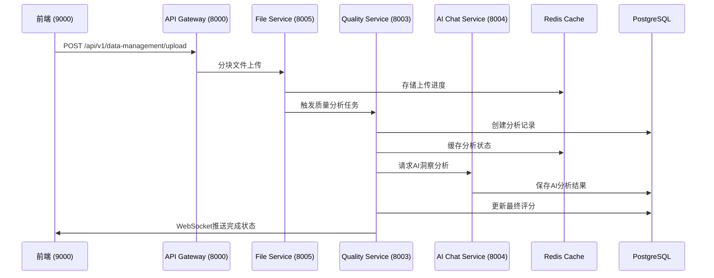
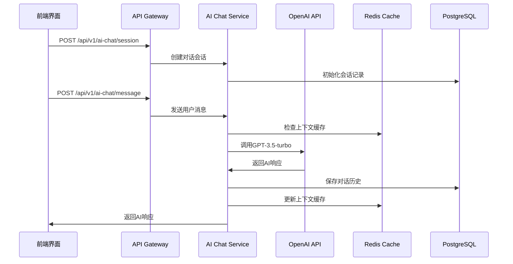

# 数据管理功能 - 系统架构设计

## 🏗️ 架构概览

基于现有的FastAPI微服务架构，为数据管理功能设计分布式、高性能的后端系统，支持4维度质量评估、AI分析和实时对话功能。

### 核心架构原则

- **微服务解耦**: 基于现有backend-pro1/pro2架构，新增数据管理专用服务
- **异步处理**: 利用Celery + Redis实现大文件处理和AI分析的异步队列
- **缓存优化**: 多层缓存策略，确保30秒内完成100MB文件分析
- **可扩展性**: 水平扩展设计，支持未来功能扩展

## 🎯 服务架构设计

### 新增微服务组件

#### 1. 数据质量分析服务 (Data Quality Service)
**端口分配**:
- backend-pro1: 8003
- backend-pro2: 8103

**核心功能**:
- 4维度质量评估算法实现
- 数据完整性、一致性、准确性、时效性分析
- 质量分数计算和历史追踪
- 批量数据处理和增量分析

#### 2. AI对话管理服务 (AI Chat Service)
**端口分配**:
- backend-pro1: 8004
- backend-pro2: 8104

**核心功能**:
- OpenAI GPT-3.5-turbo集成
- 多轮对话状态管理
- 上下文感知的AI分析
- 对话历史存储和检索

#### 3. 文件处理服务 (File Processing Service)
**端口分配**:
- backend-pro1: 8005
- backend-pro2: 8105

**核心功能**:
- 大文件分块上传处理
- 多格式文件解析 (CSV, Excel, JSON, Parquet)
- 文件安全扫描和验证
- 临时文件管理和清理

### 现有服务扩展

#### API Gateway 扩展 (8000/8100)
```python
# 新增路由组
/api/v1/data-management/*     # 数据管理总入口
/api/v1/quality-analysis/*    # 质量分析接口
/api/v1/ai-chat/*            # AI对话接口
/api/v1/file-processing/*    # 文件处理接口
```

#### Data Service 扩展 (8001/8101)
```python
# 扩展现有数据服务
/upload/quality-data         # 质量分析专用上传
/manage/quality-datasets     # 质量数据集管理
/process/quality-analysis    # 质量分析任务处理
```

## 🔄 服务交互流程

### 数据上传和质量分析流程



### AI对话和洞察生成流程



## 🗄️ 数据存储架构

### PostgreSQL数据分布策略

**开发环境数据库 (47.79.87.199:5432)**:
- `saascontrol_dev_pro1` - 主数据库
- `saascontrol_dev_pro2` - 扩展数据库

**表分布策略**:
```sql
-- 主数据库 (pro1) - 核心业务数据
- data_sources           -- 数据源管理
- quality_assessments    -- 质量评估记录
- scoring_history        -- 评分历史
- user_sessions         -- 用户会话

-- 扩展数据库 (pro2) - AI和对话数据
- ai_analysis_results   -- AI分析结果
- conversation_history  -- 对话历史
- ai_chat_sessions     -- AI会话管理
- model_usage_logs     -- 模型使用日志
```

### Redis缓存策略

**缓存分层设计**:
```python
# L1 缓存 - 热点数据 (TTL: 5分钟)
quality_analysis:{analysis_id}:status
quality_analysis:{analysis_id}:progress
file_upload:{upload_id}:chunks

# L2 缓存 - 计算结果 (TTL: 30分钟)
quality_scores:{data_source_id}:latest
ai_analysis:{session_id}:context
quality_dimensions:{analysis_id}:results

# L3 缓存 - 用户数据 (TTL: 2小时)
user_quality_dashboard:{user_id}:data
ai_chat_history:{session_id}:recent
```

## ⚡ 异步任务架构

### Celery任务队列设计

**队列分类**:
```python
# 高优先级队列 (用户交互相关)
user_interaction_queue:
  - file_upload_processing
  - quick_quality_check
  - ai_chat_response

# 标准队列 (数据分析)
data_analysis_queue:
  - comprehensive_quality_analysis
  - dimension_scoring
  - trend_analysis

# 低优先级队列 (后台任务)
background_queue:
  - cleanup_temp_files
  - generate_reports
  - update_statistics
```

**任务处理架构**:
```python
# Celery Worker配置
CELERY_ROUTES = {
    'quality_analysis.tasks.analyze_data_quality': {
        'queue': 'data_analysis_queue',
        'routing_key': 'analysis.quality'
    },
    'ai_chat.tasks.generate_ai_response': {
        'queue': 'user_interaction_queue',
        'routing_key': 'user.ai_chat'
    },
    'file_processing.tasks.process_large_file': {
        'queue': 'data_analysis_queue',
        'routing_key': 'data.processing'
    }
}
```

## 🚀 性能优化策略

### 大文件处理优化

**分块处理机制**:
```python
# 文件分块策略
CHUNK_SIZE = 8 * 1024 * 1024  # 8MB chunks
MAX_FILE_SIZE = 100 * 1024 * 1024  # 100MB limit

# 异步分块处理
async def process_file_chunks(file_path: str):
    chunks = split_file_into_chunks(file_path, CHUNK_SIZE)
    tasks = [process_chunk.delay(chunk) for chunk in chunks]
    results = await asyncio.gather(*tasks)
    return merge_chunk_results(results)
```

**并行质量分析**:
```python
# 4维度并行分析
async def parallel_quality_analysis(data_frame):
    tasks = [
        analyze_completeness.delay(data_frame),
        analyze_consistency.delay(data_frame),
        analyze_accuracy.delay(data_frame),
        analyze_timeliness.delay(data_frame)
    ]

    results = await asyncio.gather(*tasks)
    return calculate_composite_score(results)
```

### 缓存命中率优化

**智能缓存预热**:
```python
# 预测性缓存策略
async def preload_quality_cache(user_id: str):
    recent_datasets = await get_user_recent_datasets(user_id)
    for dataset in recent_datasets:
        cache_key = f"quality_scores:{dataset.id}:latest"
        if not await redis.exists(cache_key):
            score = await calculate_quality_score(dataset.id)
            await redis.setex(cache_key, 1800, json.dumps(score))
```

## 🔒 安全架构设计

### API安全策略

**多层认证机制**:
```python
# JWT Token验证 + API Key验证
@require_auth
@require_api_key
@rate_limit(rate="100/minute")
async def upload_quality_data(request: Request):
    pass

# 文件安全扫描
async def validate_file_security(file_path: str):
    # 1. 文件类型验证
    if not is_allowed_file_type(file_path):
        raise SecurityError("Unsupported file type")

    # 2. 病毒扫描
    scan_result = await virus_scan(file_path)
    if not scan_result.is_clean:
        raise SecurityError("File contains malware")

    # 3. 内容验证
    if not validate_file_content(file_path):
        raise SecurityError("Invalid file content")
```

### 数据隔离策略

**租户级数据隔离**:
```python
# 数据访问控制
class DataAccessControl:
    async def validate_data_access(self, user_id: str, data_source_id: str):
        data_source = await self.get_data_source(data_source_id)
        if data_source.owner_id != user_id:
            if not await self.check_shared_permission(user_id, data_source_id):
                raise PermissionError("Access denied")
        return True
```

## 📊 监控和可观测性

### 自定义指标收集

**业务指标**:
```python
# Prometheus自定义指标
quality_analysis_duration = Histogram(
    'quality_analysis_duration_seconds',
    'Time spent on quality analysis',
    ['dimension', 'file_size_category']
)

ai_response_time = Histogram(
    'ai_response_time_seconds',
    'AI service response time',
    ['model', 'prompt_type']
)

data_quality_scores = Gauge(
    'data_quality_scores',
    'Current data quality scores',
    ['user_id', 'data_source_id', 'dimension']
)
```

### 健康检查增强

**深度健康检查**:
```python
@router.get("/health/detailed")
async def detailed_health_check():
    checks = {
        "database": await check_database_connection(),
        "redis": await check_redis_connection(),
        "openai_api": await check_openai_api(),
        "celery_workers": await check_celery_workers(),
        "file_storage": await check_file_storage_space()
    }

    overall_status = "healthy" if all(checks.values()) else "degraded"
    return {"status": overall_status, "checks": checks}
```

## 🔄 部署架构

### Docker服务编排

**新增服务配置**:
```yaml
# docker-compose.yml 扩展
services:
  quality-service:
    build: ./quality-service
    ports:
      - "8003:8003"
    environment:
      - SERVICE_PORT=8003
      - DATABASE_URL=${DATABASE_URL}
      - REDIS_URL=${REDIS_URL}
    depends_on:
      - postgres
      - redis

  ai-chat-service:
    build: ./ai-chat-service
    ports:
      - "8004:8004"
    environment:
      - SERVICE_PORT=8004
      - OPENAI_API_KEY=${OPENAI_API_KEY}

  file-processing-service:
    build: ./file-processing-service
    ports:
      - "8005:8005"
    volumes:
      - ./temp_files:/app/temp_files
```

### 水平扩展策略

**服务副本配置**:
```yaml
# Kubernetes部署配置
apiVersion: apps/v1
kind: Deployment
metadata:
  name: quality-service
spec:
  replicas: 3  # 根据负载动态调整
  selector:
    matchLabels:
      app: quality-service
  template:
    spec:
      containers:
      - name: quality-service
        image: saascontrol/quality-service:latest
        resources:
          requests:
            memory: "256Mi"
            cpu: "250m"
          limits:
            memory: "512Mi"
            cpu: "500m"
```

## 📈 容量规划

### 性能目标

**核心性能指标**:
- 文件上传: 100MB文件 < 30秒处理完成
- 质量分析: 4维度分析 < 15秒
- AI响应: 对话响应 < 3秒
- 并发用户: 支持100+并发用户
- API响应: 缓存命中 < 100ms

**资源配置建议**:
```python
# 生产环境资源配置
PRODUCTION_RESOURCES = {
    "api_gateway": {"cpu": "1000m", "memory": "1Gi", "replicas": 2},
    "quality_service": {"cpu": "2000m", "memory": "2Gi", "replicas": 3},
    "ai_chat_service": {"cpu": "1000m", "memory": "1Gi", "replicas": 2},
    "file_processing": {"cpu": "1500m", "memory": "1.5Gi", "replicas": 2},
    "celery_workers": {"cpu": "2000m", "memory": "2Gi", "replicas": 4}
}
```

## 🎯 架构决策记录

### ADR-001: 微服务拆分策略
**决策**: 将数据管理功能拆分为3个独立微服务
**理由**:
- 职责单一，便于维护和扩展
- 独立部署和扩展
- 故障隔离，提高系统可靠性

### ADR-002: AI服务集成方式
**决策**: 采用OpenAI API + 本地对话管理
**理由**:
- 快速迭代，降低开发复杂度
- 成本可控，按需付费
- 未来可扩展到自部署模型

### ADR-003: 缓存策略选择
**决策**: Redis多层缓存 + 智能预热
**理由**:
- 显著提升响应速度
- 减少数据库压力
- 支持复杂缓存策略

这个系统架构设计为数据管理功能提供了完整、可扩展的后端基础，确保在6天开发周期内能够快速实现并支持未来的功能扩展。