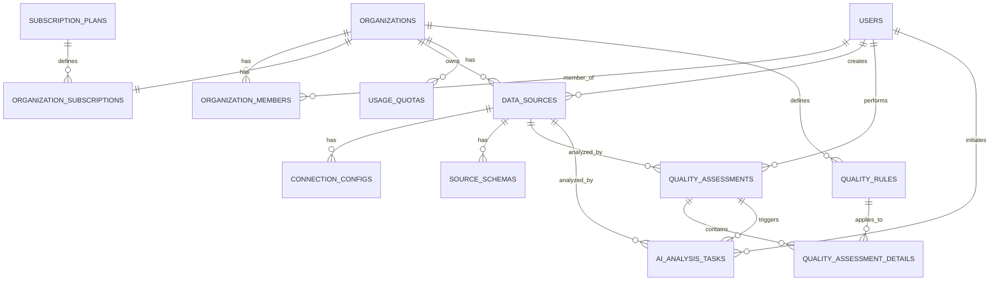

# 扩展数据库设计 - 商业化数据管理平台

## 📊 架构设计理念

基于之前的Analytics Reporter商业性扩展分析，设计支持多种数据源类型、多用户层级和企业级功能的完整数据库架构。该设计充分考虑了从免费版到企业版的功能差异化需求。

## 🗄️ 核心数据模型扩展

### 1. 数据源管理模块 (Enhanced)

#### 数据源主表 - 支持多种数据源类型

```sql
CREATE TABLE data_sources (
    id UUID PRIMARY KEY DEFAULT gen_random_uuid(),
    organization_id UUID NOT NULL REFERENCES organizations(id) ON DELETE CASCADE,
    user_id UUID NOT NULL REFERENCES users(id) ON DELETE CASCADE,

    -- 基本信息
    name VARCHAR(255) NOT NULL,
    description TEXT,
    source_type VARCHAR(50) NOT NULL, -- 'file', 'database', 'api', 'cloud_storage', 'stream'
    source_subtype VARCHAR(50) NOT NULL, -- 'csv', 'mysql', 'rest_api', 's3', 'kafka'

    -- 文件类型数据源
    file_path TEXT,
    file_size BIGINT,
    file_format VARCHAR(20), -- 'csv', 'excel', 'json', 'parquet', 'xml'
    encoding VARCHAR(20) DEFAULT 'utf-8',
    delimiter VARCHAR(5) DEFAULT ',',
    has_header BOOLEAN DEFAULT TRUE,

    -- 数据库类型数据源
    connection_config JSONB, -- {host, port, database, etc.}
    query_config JSONB, -- {table_name, query, filters}

    -- API类型数据源
    api_endpoint TEXT,
    api_method VARCHAR(10) DEFAULT 'GET',
    api_headers JSONB,
    api_auth_config JSONB, -- 加密存储

    -- 云存储类型数据源
    cloud_provider VARCHAR(20), -- 'aws', 'gcp', 'azure', 'alibaba'
    cloud_region VARCHAR(50),
    cloud_bucket TEXT,
    cloud_path TEXT,
    cloud_credentials JSONB, -- 加密存储

    -- 实时流数据源
    stream_endpoint TEXT,
    stream_protocol VARCHAR(20), -- 'kafka', 'websocket', 'mqtt'
    stream_config JSONB,

    -- 数据统计
    row_count BIGINT,
    column_count INTEGER,
    data_size_bytes BIGINT,

    -- 处理状态
    status VARCHAR(20) DEFAULT 'pending', -- 'pending', 'connecting', 'processing', 'ready', 'error'
    processing_progress INTEGER DEFAULT 0, -- 0-100
    error_message TEXT,
    last_sync_at TIMESTAMP WITH TIME ZONE,
    next_sync_at TIMESTAMP WITH TIME ZONE,

    -- 元数据
    schema_metadata JSONB, -- 字段信息、类型等
    quality_metadata JSONB, -- 质量预检结果
    business_metadata JSONB, -- 业务标签、分类等

    -- 版本和控制
    version INTEGER DEFAULT 1,
    is_active BOOLEAN DEFAULT TRUE,
    is_public BOOLEAN DEFAULT FALSE, -- 是否在组织内公开
    access_level VARCHAR(20) DEFAULT 'private', -- 'private', 'team', 'organization', 'public'

    -- 时间戳
    created_at TIMESTAMP WITH TIME ZONE DEFAULT NOW(),
    updated_at TIMESTAMP WITH TIME ZONE DEFAULT NOW(),
    accessed_at TIMESTAMP WITH TIME ZONE DEFAULT NOW(),

    -- 约束
    CONSTRAINT valid_source_type CHECK (source_type IN ('file', 'database', 'api', 'cloud_storage', 'stream')),
    CONSTRAINT valid_status CHECK (status IN ('pending', 'connecting', 'processing', 'ready', 'error')),
    CONSTRAINT valid_access_level CHECK (access_level IN ('private', 'team', 'organization', 'public'))
);

-- 索引优化
CREATE INDEX idx_data_sources_org_user ON data_sources(organization_id, user_id);
CREATE INDEX idx_data_sources_type_status ON data_sources(source_type, status);
CREATE INDEX idx_data_sources_public_access ON data_sources(organization_id, is_public, access_level);
CREATE INDEX idx_data_sources_sync_schedule ON data_sources(next_sync_at) WHERE status = 'ready';

-- GIN索引用于JSON查询
CREATE INDEX idx_data_sources_connection_config ON data_sources USING GIN(connection_config);
CREATE INDEX idx_data_sources_schema_metadata ON data_sources USING GIN(schema_metadata);
```

#### 数据源连接配置表

```sql
CREATE TABLE connection_configs (
    id UUID PRIMARY KEY DEFAULT gen_random_uuid(),
    data_source_id UUID NOT NULL REFERENCES data_sources(id) ON DELETE CASCADE,
    organization_id UUID NOT NULL REFERENCES organizations(id) ON DELETE CASCADE,

    -- 连接信息
    config_name VARCHAR(255) NOT NULL,
    config_type VARCHAR(50) NOT NULL, -- 'database', 'api', 'cloud', 'stream'

    -- 连接参数 (加密存储)
    connection_string TEXT, -- 加密后的连接字符串
    credentials_encrypted BYTEA, -- 加密的凭据信息
    ssl_config JSONB,
    timeout_seconds INTEGER DEFAULT 30,
    retry_attempts INTEGER DEFAULT 3,

    -- 连接池配置
    pool_size INTEGER DEFAULT 5,
    max_overflow INTEGER DEFAULT 10,
    pool_timeout INTEGER DEFAULT 30,

    -- 安全配置
    allowed_ips INET[],
    require_ssl BOOLEAN DEFAULT TRUE,
    certificate_path TEXT,

    -- 状态监控
    is_active BOOLEAN DEFAULT TRUE,
    last_test_at TIMESTAMP WITH TIME ZONE,
    test_result VARCHAR(20), -- 'success', 'failed', 'timeout'
    test_error_message TEXT,

    created_at TIMESTAMP WITH TIME ZONE DEFAULT NOW(),
    updated_at TIMESTAMP WITH TIME ZONE DEFAULT NOW(),

    UNIQUE(data_source_id, config_name)
);

-- 索引
CREATE INDEX idx_connection_configs_source ON connection_configs(data_source_id);
CREATE INDEX idx_connection_configs_type_active ON connection_configs(config_type, is_active);
```

#### 数据源Schema映射表

```sql
CREATE TABLE source_schemas (
    id UUID PRIMARY KEY DEFAULT gen_random_uuid(),
    data_source_id UUID NOT NULL REFERENCES data_sources(id) ON DELETE CASCADE,

    -- Schema信息
    schema_version INTEGER DEFAULT 1,
    detected_at TIMESTAMP WITH TIME ZONE DEFAULT NOW(),

    -- 字段定义
    fields JSONB NOT NULL, -- 详细的字段信息
    primary_keys TEXT[],
    foreign_keys JSONB,
    indexes JSONB,

    -- 数据分布统计
    total_rows BIGINT,
    data_size_bytes BIGINT,
    null_percentage DECIMAL(5,2),
    unique_percentage DECIMAL(5,2),

    -- 数据类型分析
    numeric_fields TEXT[],
    text_fields TEXT[],
    date_fields TEXT[],
    boolean_fields TEXT[],
    json_fields TEXT[],

    -- 业务映射
    business_entity VARCHAR(100), -- 业务实体名称
    business_fields JSONB, -- 业务字段映射
    data_classification JSONB, -- 数据分类标签

    -- 质量预检
    quality_issues JSONB, -- 发现的质量问题
    recommendations JSONB, -- 改进建议

    is_current BOOLEAN DEFAULT TRUE,
    created_at TIMESTAMP WITH TIME ZONE DEFAULT NOW()
);

-- 索引
CREATE INDEX idx_source_schemas_source_current ON source_schemas(data_source_id, is_current);
CREATE INDEX idx_source_schemas_entity ON source_schemas(business_entity);
CREATE INDEX idx_source_schemas_detected ON source_schemas(detected_at DESC);
```

### 2. 质量评估模块 (Enhanced)

#### 质量评估主表

```sql
CREATE TABLE quality_assessments (
    id UUID PRIMARY KEY DEFAULT gen_random_uuid(),
    data_source_id UUID NOT NULL REFERENCES data_sources(id) ON DELETE CASCADE,
    organization_id UUID NOT NULL REFERENCES organizations(id) ON DELETE CASCADE,
    user_id UUID NOT NULL REFERENCES users(id) ON DELETE CASCADE,

    -- 评估配置
    assessment_name VARCHAR(255),
    assessment_type VARCHAR(50) DEFAULT 'full', -- 'full', 'incremental', 'sample', 'real_time'
    assessment_scope JSONB, -- 评估范围配置
    assessment_config JSONB, -- 评估参数配置

    -- 4维度质量评分 (0-100)
    completeness_score DECIMAL(5,2) CHECK (completeness_score >= 0 AND completeness_score <= 100),
    consistency_score DECIMAL(5,2) CHECK (consistency_score >= 0 AND consistency_score <= 100),
    accuracy_score DECIMAL(5,2) CHECK (accuracy_score >= 0 AND accuracy_score <= 100),
    timeliness_score DECIMAL(5,2) CHECK (timeliness_score >= 0 AND timeliness_score <= 100),

    -- 扩展质量维度
    validity_score DECIMAL(5,2) CHECK (validity_score >= 0 AND validity_score <= 100), -- 有效性
    uniqueness_score DECIMAL(5,2) CHECK (uniqueness_score >= 0 AND uniqueness_score <= 100), -- 唯一性
    integrity_score DECIMAL(5,2) CHECK (integrity_score >= 0 AND integrity_score <= 100), -- 完整性

    -- 综合评分
    overall_score DECIMAL(5,2) CHECK (overall_score >= 0 AND overall_score <= 100),
    weighted_score DECIMAL(5,2) CHECK (weighted_score >= 0 AND weighted_score <= 100),
    quality_grade VARCHAR(2) CHECK (quality_grade IN ('A+', 'A', 'B+', 'B', 'C+', 'C', 'D', 'F')),

    -- 详细分析结果
    dimension_details JSONB NOT NULL, -- 每个维度的详细分析
    field_level_scores JSONB, -- 字段级别的质量分数
    rule_violations JSONB, -- 规则违反详情
    anomaly_detection JSONB, -- 异常检测结果
    data_profiling JSONB, -- 数据画像结果

    -- AI增强分析
    ai_insights JSONB, -- AI生成的洞察
    improvement_suggestions JSONB, -- 改进建议
    risk_assessment JSONB, -- 风险评估
    business_impact JSONB, -- 业务影响分析

    -- 评估执行信息
    execution_mode VARCHAR(20) DEFAULT 'automatic', -- 'automatic', 'manual', 'scheduled'
    execution_engine VARCHAR(50) DEFAULT 'internal', -- 'internal', 'spark', 'dask', 'ray'
    sample_size BIGINT, -- 评估样本大小
    sample_percentage DECIMAL(5,2), -- 采样比例

    -- 状态和性能
    status VARCHAR(20) DEFAULT 'pending', -- 'pending', 'running', 'completed', 'failed', 'cancelled'
    progress_percentage INTEGER DEFAULT 0,
    execution_duration_ms BIGINT, -- 执行耗时(毫秒)
    cpu_time_ms BIGINT, -- CPU时间
    memory_usage_mb INTEGER, -- 内存使用量

    -- 错误处理
    error_code VARCHAR(50),
    error_message TEXT,
    error_details JSONB,
    retry_count INTEGER DEFAULT 0,

    -- 调度信息
    scheduled_by UUID REFERENCES users(id),
    schedule_config JSONB, -- 调度配置
    parent_assessment_id UUID REFERENCES quality_assessments(id), -- 增量评估的父评估

    -- 时间戳
    created_at TIMESTAMP WITH TIME ZONE DEFAULT NOW(),
    started_at TIMESTAMP WITH TIME ZONE,
    completed_at TIMESTAMP WITH TIME ZONE,
    expires_at TIMESTAMP WITH TIME ZONE DEFAULT (NOW() + INTERVAL '90 days'),

    CONSTRAINT valid_status CHECK (status IN ('pending', 'running', 'completed', 'failed', 'cancelled')),
    CONSTRAINT valid_assessment_type CHECK (assessment_type IN ('full', 'incremental', 'sample', 'real_time')),
    CONSTRAINT valid_execution_mode CHECK (execution_mode IN ('automatic', 'manual', 'scheduled'))
);

-- 索引优化
CREATE INDEX idx_quality_assessments_source_org ON quality_assessments(data_source_id, organization_id);
CREATE INDEX idx_quality_assessments_user_status ON quality_assessments(user_id, status);
CREATE INDEX idx_quality_assessments_overall_score ON quality_assessments(overall_score DESC);
CREATE INDEX idx_quality_assessments_created_date ON quality_assessments(created_at DESC);
CREATE INDEX idx_quality_assessments_schedule ON quality_assessments(scheduled_by, status) WHERE execution_mode = 'scheduled';

-- 部分索引
CREATE INDEX idx_quality_assessments_active ON quality_assessments(data_source_id, overall_score DESC)
WHERE status = 'completed' AND expires_at > NOW();
```

#### 质量规则配置表

```sql
CREATE TABLE quality_rules (
    id UUID PRIMARY KEY DEFAULT gen_random_uuid(),
    organization_id UUID NOT NULL REFERENCES organizations(id) ON DELETE CASCADE,

    -- 规则基本信息
    rule_name VARCHAR(255) NOT NULL,
    rule_category VARCHAR(50) NOT NULL, -- 'completeness', 'consistency', 'accuracy', 'validity', 'uniqueness'
    rule_type VARCHAR(50) NOT NULL, -- 'field_null_check', 'format_validation', 'range_check', 'reference_check'
    description TEXT,

    -- 规则定义
    rule_definition JSONB NOT NULL, -- 规则的具体定义
    rule_expression TEXT, -- SQL或其他表达式
    threshold_config JSONB, -- 阈值配置
    severity VARCHAR(20) DEFAULT 'medium', -- 'low', 'medium', 'high', 'critical'

    -- 适用范围
    applicable_data_types TEXT[], -- 适用的数据类型
    applicable_source_types TEXT[], -- 适用的数据源类型
    field_patterns TEXT[], -- 适用的字段模式

    -- 执行配置
    is_active BOOLEAN DEFAULT TRUE,
    is_custom BOOLEAN DEFAULT FALSE, -- 是否为用户自定义规则
    execution_order INTEGER DEFAULT 100,
    execution_timeout_seconds INTEGER DEFAULT 300,

    -- 业务配置
    business_context JSONB, -- 业务上下文
    tags TEXT[], -- 标签

    -- 创建信息
    created_by UUID REFERENCES users(id),
    created_at TIMESTAMP WITH TIME ZONE DEFAULT NOW(),
    updated_at TIMESTAMP WITH TIME ZONE DEFAULT NOW(),

    CONSTRAINT valid_severity CHECK (severity IN ('low', 'medium', 'high', 'critical'))
);

-- 索引
CREATE INDEX idx_quality_rules_org_category ON quality_rules(organization_id, rule_category);
CREATE INDEX idx_quality_rules_type_active ON quality_rules(rule_type, is_active);
CREATE INDEX idx_quality_rules_severity ON quality_rules(severity);
CREATE INDEX idx_quality_rules_tags ON quality_rules USING GIN(tags);
```

#### 质量评估详细结果表

```sql
CREATE TABLE quality_assessment_details (
    id UUID PRIMARY KEY DEFAULT gen_random_uuid(),
    assessment_id UUID NOT NULL REFERENCES quality_assessments(id) ON DELETE CASCADE,
    data_source_id UUID NOT NULL REFERENCES data_sources(id) ON DELETE CASCADE,

    -- 检查项信息
    check_type VARCHAR(50) NOT NULL, -- 'field_level', 'record_level', 'dataset_level', 'cross_dataset'
    check_category VARCHAR(50) NOT NULL,
    check_name VARCHAR(255) NOT NULL,
    field_name VARCHAR(255), -- 字段级检查的字段名

    -- 检查结果
    passed_count BIGINT DEFAULT 0,
    failed_count BIGINT DEFAULT 0,
    total_count BIGINT DEFAULT 0,
    pass_rate DECIMAL(5,2), -- 通过率

    -- 详细结果
    check_result JSONB, -- 详细的检查结果
    violation_samples JSONB, -- 违反规则的样本数据
    statistics JSONB, -- 统计信息

    -- 评分
    quality_score DECIMAL(5,2),
    weight_factor DECIMAL(3,2) DEFAULT 1.0,
    weighted_score DECIMAL(5,2),

    -- 建议
    recommendations TEXT[],
    fix_suggestions JSONB,

    created_at TIMESTAMP WITH TIME ZONE DEFAULT NOW()
);

-- 索引
CREATE INDEX idx_quality_details_assessment ON quality_assessment_details(assessment_id);
CREATE INDEX idx_quality_details_field ON quality_assessment_details(assessment_id, field_name);
CREATE INDEX idx_quality_details_category ON quality_assessment_details(check_category, quality_score);
```

### 3. 商业化订阅模块

#### 订阅计划表

```sql
CREATE TABLE subscription_plans (
    id UUID PRIMARY KEY DEFAULT gen_random_uuid(),

    -- 计划基本信息
    plan_name VARCHAR(100) NOT NULL UNIQUE,
    plan_tier VARCHAR(20) NOT NULL, -- 'free', 'professional', 'enterprise', 'custom'
    display_name VARCHAR(255) NOT NULL,
    description TEXT,

    -- 定价信息
    price_monthly_cents INTEGER NOT NULL,
    price_annual_cents INTEGER,
    currency VARCHAR(3) DEFAULT 'CNY',
    billing_cycles TEXT[] DEFAULT ARRAY['monthly', 'annual'],

    -- 功能限制
    max_users INTEGER, -- NULL表示无限制
    max_organizations INTEGER DEFAULT 1,
    max_data_sources INTEGER,
    max_storage_gb INTEGER,
    max_api_calls_per_month INTEGER,
    max_ai_analysis_per_month INTEGER,
    max_quality_assessments_per_month INTEGER,

    -- 数据源类型限制
    allowed_source_types TEXT[], -- ['file'] for free, ['file', 'database', 'api'] for pro
    max_file_size_mb INTEGER,
    max_database_connections INTEGER,
    max_api_endpoints INTEGER,

    -- AI功能限制
    ai_features_enabled BOOLEAN DEFAULT FALSE,
    max_ai_tokens_per_month INTEGER,
    ai_model_access TEXT[], -- 可访问的AI模型

    -- 高级功能
    real_time_sync_enabled BOOLEAN DEFAULT FALSE,
    custom_rules_enabled BOOLEAN DEFAULT FALSE,
    api_access_enabled BOOLEAN DEFAULT FALSE,
    white_label_enabled BOOLEAN DEFAULT FALSE,
    priority_support BOOLEAN DEFAULT FALSE,
    sla_guarantee VARCHAR(50), -- '99.9%', '99.99%'

    -- 状态
    is_active BOOLEAN DEFAULT TRUE,
    is_public BOOLEAN DEFAULT TRUE, -- 是否公开展示
    sort_order INTEGER DEFAULT 100,

    -- 元数据
    features_json JSONB, -- 详细功能列表
    limitations_json JSONB, -- 详细限制说明

    created_at TIMESTAMP WITH TIME ZONE DEFAULT NOW(),
    updated_at TIMESTAMP WITH TIME ZONE DEFAULT NOW(),

    CONSTRAINT valid_plan_tier CHECK (plan_tier IN ('free', 'professional', 'enterprise', 'custom'))
);

-- 插入默认计划
INSERT INTO subscription_plans (plan_name, plan_tier, display_name, description, price_monthly_cents,
                               max_users, max_data_sources, max_storage_gb, max_file_size_mb,
                               allowed_source_types, ai_features_enabled) VALUES
('free', 'free', '免费版', '适合个人用户和小团队', 0, 5, 10, 1, 10,
 ARRAY['file'], FALSE),
('professional', 'professional', '专业版', '适合成长中的企业', 9900, 50, 100, 100, 100,
 ARRAY['file', 'database', 'api'], TRUE),
('enterprise', 'enterprise', '企业版', '适合大型企业', 29900, NULL, NULL, 1000, 1000,
 ARRAY['file', 'database', 'api', 'cloud_storage', 'stream'], TRUE);
```

#### 组织订阅表

```sql
CREATE TABLE organization_subscriptions (
    id UUID PRIMARY KEY DEFAULT gen_random_uuid(),
    organization_id UUID NOT NULL REFERENCES organizations(id) ON DELETE CASCADE,
    plan_id UUID NOT NULL REFERENCES subscription_plans(id),

    -- 订阅信息
    subscription_status VARCHAR(20) DEFAULT 'active', -- 'trial', 'active', 'suspended', 'cancelled', 'expired'
    billing_cycle VARCHAR(20) NOT NULL, -- 'monthly', 'annual'

    -- 定价信息
    monthly_price_cents INTEGER NOT NULL,
    annual_price_cents INTEGER,
    currency VARCHAR(3) DEFAULT 'CNY',

    -- 试用信息
    trial_starts_at TIMESTAMP WITH TIME ZONE,
    trial_ends_at TIMESTAMP WITH TIME ZONE,
    is_trial BOOLEAN DEFAULT FALSE,

    -- 订阅周期
    current_period_starts_at TIMESTAMP WITH TIME ZONE NOT NULL,
    current_period_ends_at TIMESTAMP WITH TIME ZONE NOT NULL,
    next_billing_date TIMESTAMP WITH TIME ZONE,

    -- 自动续费
    auto_renew BOOLEAN DEFAULT TRUE,
    renewal_reminder_sent BOOLEAN DEFAULT FALSE,

    -- 支付信息
    payment_method_id VARCHAR(255), -- 外部支付方式ID
    last_payment_at TIMESTAMP WITH TIME ZONE,
    last_payment_amount_cents INTEGER,

    -- 变更历史
    previous_plan_id UUID REFERENCES subscription_plans(id),
    upgrade_downgrade_at TIMESTAMP WITH TIME ZONE,

    -- 取消信息
    cancelled_at TIMESTAMP WITH TIME ZONE,
    cancellation_reason TEXT,
    cancel_at_period_end BOOLEAN DEFAULT FALSE,

    created_at TIMESTAMP WITH TIME ZONE DEFAULT NOW(),
    updated_at TIMESTAMP WITH TIME ZONE DEFAULT NOW(),

    CONSTRAINT valid_subscription_status CHECK (subscription_status IN ('trial', 'active', 'suspended', 'cancelled', 'expired')),
    CONSTRAINT valid_billing_cycle CHECK (billing_cycle IN ('monthly', 'annual'))
);

-- 索引
CREATE INDEX idx_org_subscriptions_org ON organization_subscriptions(organization_id);
CREATE INDEX idx_org_subscriptions_status ON organization_subscriptions(subscription_status);
CREATE INDEX idx_org_subscriptions_billing_date ON organization_subscriptions(next_billing_date);
CREATE INDEX idx_org_subscriptions_trial ON organization_subscriptions(is_trial, trial_ends_at);
```

### 4. AI分析模块 (Enhanced)

#### AI分析任务表

```sql
CREATE TABLE ai_analysis_tasks (
    id UUID PRIMARY KEY DEFAULT gen_random_uuid(),
    organization_id UUID NOT NULL REFERENCES organizations(id) ON DELETE CASCADE,
    user_id UUID NOT NULL REFERENCES users(id) ON DELETE CASCADE,
    data_source_id UUID NOT NULL REFERENCES data_sources(id) ON DELETE CASCADE,
    quality_assessment_id UUID REFERENCES quality_assessments(id),

    -- 任务信息
    task_name VARCHAR(255) NOT NULL,
    task_type VARCHAR(50) NOT NULL, -- 'quality_analysis', 'insight_generation', 'recommendation', 'anomaly_detection'
    analysis_scope VARCHAR(50) DEFAULT 'full', -- 'full', 'sample', 'incremental', 'field_specific'

    -- AI配置
    ai_model VARCHAR(100) NOT NULL DEFAULT 'gpt-3.5-turbo',
    model_version VARCHAR(50),
    model_config JSONB,
    prompt_template TEXT,
    custom_instructions TEXT,

    -- 输入配置
    input_data_config JSONB, -- 输入数据配置
    context_data JSONB, -- 上下文数据
    analysis_parameters JSONB, -- 分析参数

    -- 执行信息
    status VARCHAR(20) DEFAULT 'pending', -- 'pending', 'running', 'completed', 'failed', 'timeout'
    priority INTEGER DEFAULT 50, -- 1-100, 数字越大优先级越高
    execution_mode VARCHAR(20) DEFAULT 'async', -- 'sync', 'async', 'batch'

    -- 性能统计
    prompt_tokens INTEGER,
    completion_tokens INTEGER,
    total_tokens INTEGER,
    api_cost_cents INTEGER, -- API调用成本
    execution_duration_ms BIGINT,
    queue_time_ms BIGINT,

    -- 结果
    analysis_results JSONB,
    insights JSONB,
    recommendations JSONB,
    confidence_scores JSONB,
    visualization_config JSONB,

    -- 错误处理
    error_code VARCHAR(50),
    error_message TEXT,
    retry_count INTEGER DEFAULT 0,
    max_retries INTEGER DEFAULT 3,

    -- 调度信息
    scheduled_at TIMESTAMP WITH TIME ZONE,
    started_at TIMESTAMP WITH TIME ZONE,
    completed_at TIMESTAMP WITH TIME ZONE,

    created_at TIMESTAMP WITH TIME ZONE DEFAULT NOW(),
    updated_at TIMESTAMP WITH TIME ZONE DEFAULT NOW(),

    CONSTRAINT valid_status CHECK (status IN ('pending', 'running', 'completed', 'failed', 'timeout')),
    CONSTRAINT valid_task_type CHECK (task_type IN ('quality_analysis', 'insight_generation', 'recommendation', 'anomaly_detection'))
);

-- 索引
CREATE INDEX idx_ai_analysis_org_user ON ai_analysis_tasks(organization_id, user_id);
CREATE INDEX idx_ai_analysis_source ON ai_analysis_tasks(data_source_id);
CREATE INDEX idx_ai_analysis_status_priority ON ai_analysis_tasks(status, priority DESC);
CREATE INDEX idx_ai_analysis_scheduled ON ai_analysis_tasks(scheduled_at) WHERE status = 'pending';
```

## 📊 数据模型关系图



## 🔍 高级查询优化

### 复合索引策略

```sql
-- 组织级数据查询优化
CREATE INDEX idx_data_sources_org_type_status ON data_sources(organization_id, source_type, status);
CREATE INDEX idx_quality_assessments_org_score_date ON quality_assessments(organization_id, overall_score DESC, created_at DESC);

-- 用户工作台查询优化
CREATE INDEX idx_user_recent_activities ON quality_assessments(user_id, created_at DESC)
WHERE status = 'completed';

-- AI分析任务队列优化
CREATE INDEX idx_ai_tasks_queue ON ai_analysis_tasks(status, priority DESC, created_at ASC)
WHERE status IN ('pending', 'running');

-- 商业化功能查询优化
CREATE INDEX idx_subscription_billing ON organization_subscriptions(subscription_status, next_billing_date)
WHERE subscription_status = 'active';
```

### 分析型查询视图

```sql
-- 组织数据概览视图
CREATE VIEW organization_dashboard AS
SELECT
    o.id as organization_id,
    o.name as organization_name,
    COUNT(DISTINCT ds.id) as total_data_sources,
    COUNT(DISTINCT qa.id) as total_assessments,
    AVG(qa.overall_score) as avg_quality_score,
    COUNT(DISTINCT u.id) as active_users,
    SUM(ds.data_size_bytes) as total_data_size
FROM organizations o
LEFT JOIN data_sources ds ON o.id = ds.organization_id
LEFT JOIN quality_assessments qa ON ds.id = qa.data_source_id AND qa.status = 'completed'
LEFT JOIN organization_members om ON o.id = om.organization_id
LEFT JOIN users u ON om.user_id = u.id
GROUP BY o.id, o.name;

-- 质量趋势分析视图
CREATE VIEW quality_trends AS
SELECT
    ds.organization_id,
    ds.id as data_source_id,
    ds.name as data_source_name,
    DATE_TRUNC('week', qa.created_at) as week,
    AVG(qa.overall_score) as avg_score,
    COUNT(*) as assessment_count
FROM data_sources ds
JOIN quality_assessments qa ON ds.id = qa.data_source_id
WHERE qa.status = 'completed'
  AND qa.created_at >= NOW() - INTERVAL '12 weeks'
GROUP BY ds.organization_id, ds.id, ds.name, DATE_TRUNC('week', qa.created_at)
ORDER BY week DESC;
```

这个扩展数据库设计为商业化数据管理平台提供了完整的数据模型支持，涵盖了从免费版到企业版的所有功能需求，并为未来扩展预留了充足的灵活性。