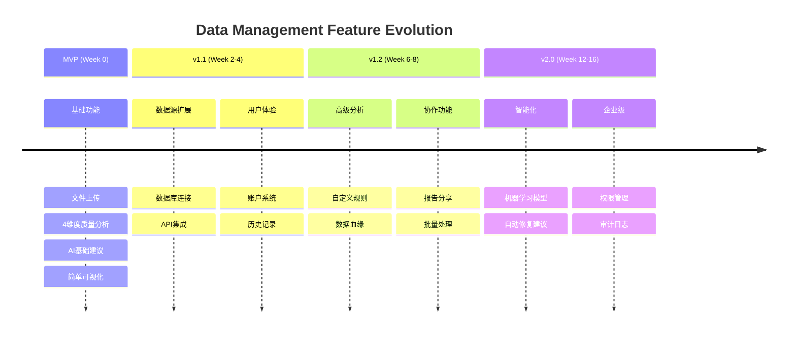
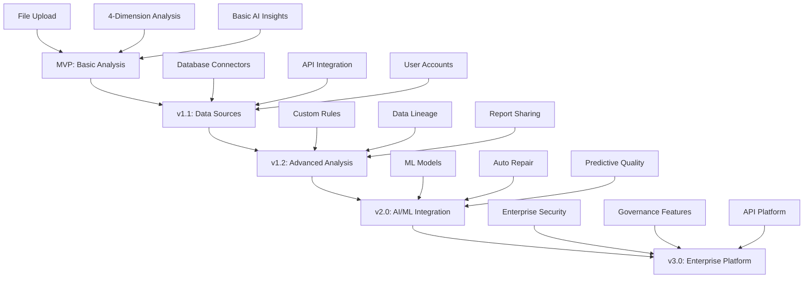
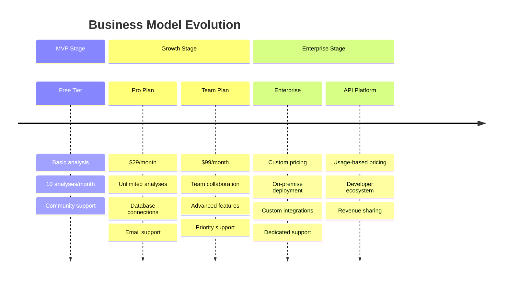

# 后期迭代路线
## Future Iterations Roadmap

**文档版本**: v1.0
**创建时间**: 2025-09-20
**设计者**: Rapid Prototyper
**项目**: SaaS Control Deck - Data Management 迭代计划
**返展期**: MVP发布后 12个月

---

## 🎯 迭代哲学

### 核心原则
- **数据驱动**: 基于MVP用户反馈和使用数据指导迭代方向
- **价值优先**: 优先开发高ROI功能，推迟低价值特性
- **技术成熟度**: 逐步引入新技术，保持系统稳定性
- **用户体验连贯**: 每次迭代都保持一致的用户体验

### 迭代规划框架


---

## 🚀 v1.1 版本 (Week 2-4): 数据源扩展

### 产品目标
- **扩大数据覆盖**: 支持更多数据源类型
- **用户粘性**: 提供账户和历史功能
- **商业验证**: 证明付费用户意愿

### 新增功能

#### 1. 数据库连接功能

##### 功能设计
```typescript
// 支持的数据库类型
const supportedDatabases = {
  mysql: {
    name: 'MySQL',
    icon: '🗄️',
    connectionFields: ['host', 'port', 'database', 'username', 'password'],
    defaultPort: 3306,
    testQuery: 'SELECT 1 as test'
  },
  postgresql: {
    name: 'PostgreSQL',
    icon: '🐘',
    connectionFields: ['host', 'port', 'database', 'username', 'password'],
    defaultPort: 5432,
    testQuery: 'SELECT 1 as test'
  },
  sqlite: {
    name: 'SQLite',
    icon: '📁',
    connectionFields: ['file_path'],
    testQuery: 'SELECT 1 as test'
  }
}

// 连接配置界面
interface DatabaseConnectionProps {
  onConnect: (config: DatabaseConfig) => void
  onTest: (config: DatabaseConfig) => Promise<boolean>
}

const DatabaseConnection = ({ onConnect, onTest }: DatabaseConnectionProps) => (
  <Card className="w-full max-w-lg">
    <CardHeader>
      <CardTitle>🔗 Connect to Database</CardTitle>
      <CardDescription>
        Analyze data quality directly from your database
      </CardDescription>
    </CardHeader>
    
    <CardContent className="space-y-4">
      {/* 数据库类型选择 */}
      <div>
        <Label>Database Type</Label>
        <Select value={dbType} onValueChange={setDbType}>
          <SelectTrigger>
            <SelectValue placeholder="Select database type" />
          </SelectTrigger>
          <SelectContent>
            {Object.entries(supportedDatabases).map(([key, db]) => (
              <SelectItem key={key} value={key}>
                {db.icon} {db.name}
              </SelectItem>
            ))}
          </SelectContent>
        </Select>
      </div>
      
      {/* 动态连接字段 */}
      {supportedDatabases[dbType]?.connectionFields.map(field => (
        <div key={field}>
          <Label className="capitalize">{field.replace('_', ' ')}</Label>
          <Input
            type={field.includes('password') ? 'password' : 'text'}
            placeholder={field === 'port' ? supportedDatabases[dbType].defaultPort : ''}
            value={connectionConfig[field] || ''}
            onChange={(e) => setConnectionConfig({
              ...connectionConfig,
              [field]: e.target.value
            })}
          />
        </div>
      ))}
      
      {/* 连接测试 */}
      <div className="flex gap-2">
        <Button 
          variant="outline" 
          onClick={() => onTest(connectionConfig)}
          disabled={testing}
        >
          {testing ? (
            <><Loader2 className="h-4 w-4 mr-2 animate-spin" />Testing...</>
          ) : (
            <><Zap className="h-4 w-4 mr-2" />Test Connection</>
          )}
        </Button>
        
        <Button 
          onClick={() => onConnect(connectionConfig)}
          disabled={!connectionValid}
          className="flex-1"
        >
          <Database className="h-4 w-4 mr-2" />
          Connect & Analyze
        </Button>
      </div>
      
      {/* 连接状态 */}
      {connectionStatus && (
        <Alert className={connectionStatus.success ? '' : 'variant-destructive'}>
          {connectionStatus.success ? (
            <CheckCircle className="h-4 w-4" />
          ) : (
            <AlertTriangle className="h-4 w-4" />
          )}
          <AlertDescription>{connectionStatus.message}</AlertDescription>
        </Alert>
      )}
    </CardContent>
  </Card>
)
```

##### 后端实现
```python
# 数据库连接管理器
class DatabaseConnector:
    """v1.1 数据库连接器"""
    
    SUPPORTED_DRIVERS = {
        'mysql': 'mysql+pymysql',
        'postgresql': 'postgresql+asyncpg',
        'sqlite': 'sqlite'
    }
    
    async def test_connection(self, config: dict) -> bool:
        """v1.1 数据库连接测试"""
        
        try:
            connection_string = self._build_connection_string(config)
            
            # 使用连接池进行测试
            engine = create_async_engine(
                connection_string,
                pool_size=1,
                max_overflow=0,
                pool_timeout=10
            )
            
            async with engine.begin() as conn:
                result = await conn.execute(text("SELECT 1 as test"))
                await result.fetchone()
            
            await engine.dispose()
            return True
            
        except Exception as e:
            logger.error(f"Database connection test failed: {e}")
            return False
    
    async def fetch_sample_data(self, config: dict, table_name: str, limit: int = 1000) -> pd.DataFrame:
        """v1.1 从数据库获取样本数据"""
        
        connection_string = self._build_connection_string(config)
        
        # 使用 pandas 直接读取
        query = f"SELECT * FROM {table_name} LIMIT {limit}"
        
        return pd.read_sql(
            query, 
            connection_string,
            parse_dates=True  # 自动解析日期列
        )
    
    async def get_table_list(self, config: dict) -> List[str]:
        """v1.1 获取数据库表列表"""
        
        db_type = config['type']
        connection_string = self._build_connection_string(config)
        
        # 不同数据库的表查询语句
        queries = {
            'mysql': "SHOW TABLES",
            'postgresql': """
                SELECT table_name 
                FROM information_schema.tables 
                WHERE table_schema = 'public'
            """,
            'sqlite': """
                SELECT name 
                FROM sqlite_master 
                WHERE type='table'
            """
        }
        
        df = pd.read_sql(queries[db_type], connection_string)
        return df.iloc[:, 0].tolist()
    
    def _build_connection_string(self, config: dict) -> str:
        """v1.1 构建数据库连接字符串"""
        
        db_type = config['type']
        driver = self.SUPPORTED_DRIVERS[db_type]
        
        if db_type == 'sqlite':
            return f"{driver}:///{config['file_path']}"
        
        # MySQL/PostgreSQL 连接字符串
        host = config['host']
        port = config.get('port', 3306 if db_type == 'mysql' else 5432)
        database = config['database']
        username = config['username']
        password = config['password']
        
        return f"{driver}://{username}:{password}@{host}:{port}/{database}"

# API 端点
@router.post("/connect/database")
async def connect_database(connection_config: DatabaseConnectionConfig):
    """v1.1 数据库连接端点"""
    
    connector = DatabaseConnector()
    
    # 测试连接
    is_connected = await connector.test_connection(connection_config.dict())
    if not is_connected:
        raise HTTPException(400, "Database connection failed")
    
    # 获取表列表
    tables = await connector.get_table_list(connection_config.dict())
    
    return {
        'connection_id': str(uuid.uuid4()),
        'status': 'connected',
        'tables': tables,
        'message': f'Successfully connected to {connection_config.type} database'
    }
```

#### 2. API数据源集成

##### REST API 连接器
```python
class APIConnector:
    """v1.1 REST API 数据源连接器"""
    
    def __init__(self):
        self.supported_auth = ['none', 'api_key', 'bearer_token', 'basic_auth']
    
    async def fetch_api_data(self, config: dict) -> pd.DataFrame:
        """v1.1 从 REST API 获取数据"""
        
        async with httpx.AsyncClient(timeout=30.0) as client:
            # 构建请求头
            headers = self._build_headers(config)
            
            # 发送请求
            response = await client.get(
                config['url'],
                headers=headers,
                params=config.get('query_params', {})
            )
            
            response.raise_for_status()
            
            # 解析响应数据
            data = response.json()
            
            # 将 JSON 转换为 DataFrame
            if isinstance(data, list):
                return pd.DataFrame(data)
            elif isinstance(data, dict):
                # 尝试找到数据数组
                data_key = self._find_data_key(data)
                if data_key:
                    return pd.DataFrame(data[data_key])
                else:
                    # 单个对象转换为单行 DataFrame
                    return pd.DataFrame([data])
            
            raise ValueError("Unsupported API response format")
    
    def _build_headers(self, config: dict) -> dict:
        """v1.1 构建请求头"""
        
        headers = {'Content-Type': 'application/json'}
        
        auth_type = config.get('auth_type', 'none')
        
        if auth_type == 'api_key':
            key_name = config.get('api_key_name', 'X-API-Key')
            headers[key_name] = config['api_key_value']
        
        elif auth_type == 'bearer_token':
            headers['Authorization'] = f"Bearer {config['bearer_token']}"
        
        elif auth_type == 'basic_auth':
            import base64
            credentials = base64.b64encode(
                f"{config['username']}:{config['password']}".encode()
            ).decode()
            headers['Authorization'] = f"Basic {credentials}"
        
        return headers
    
    def _find_data_key(self, data: dict) -> str:
        """v1.1 智能查找数据数组字段"""
        
        # 常见的数据字段名
        common_keys = ['data', 'results', 'items', 'records', 'rows']
        
        for key in common_keys:
            if key in data and isinstance(data[key], list):
                return key
        
        # 查找第一个数组类型的字段
        for key, value in data.items():
            if isinstance(value, list) and len(value) > 0:
                return key
        
        return None
```

#### 3. 用户账户系统

##### 简化的账户管理
```typescript
// 用户账户状态管理
interface User {
  id: string
  email: string
  name: string
  plan: 'free' | 'pro' | 'enterprise'
  usage: {
    analyses_this_month: number
    storage_used_mb: number
    api_calls_this_month: number
  }
  limits: {
    max_analyses_per_month: number
    max_storage_mb: number
    max_file_size_mb: number
    max_api_calls_per_month: number
  }
}

// 账户信息组件
const AccountInfo = ({ user }: { user: User }) => (
  <Card>
    <CardHeader>
      <CardTitle className="flex items-center gap-2">
        <User className="h-5 w-5" />
        Account Information
      </CardTitle>
    </CardHeader>
    
    <CardContent className="space-y-4">
      {/* 基本信息 */}
      <div>
        <Label>Email</Label>
        <p className="text-gray-900">{user.email}</p>
      </div>
      
      <div>
        <Label>Current Plan</Label>
        <Badge className={getPlanColor(user.plan)}>
          {user.plan.toUpperCase()}
        </Badge>
      </div>
      
      {/* 使用情况 */}
      <div>
        <Label>This Month's Usage</Label>
        <div className="space-y-2 mt-2">
          <div className="flex justify-between text-sm">
            <span>Analyses</span>
            <span>{user.usage.analyses_this_month} / {user.limits.max_analyses_per_month}</span>
          </div>
          <Progress 
            value={(user.usage.analyses_this_month / user.limits.max_analyses_per_month) * 100} 
            className="h-2"
          />
          
          <div className="flex justify-between text-sm">
            <span>Storage</span>
            <span>{user.usage.storage_used_mb}MB / {user.limits.max_storage_mb}MB</span>
          </div>
          <Progress 
            value={(user.usage.storage_used_mb / user.limits.max_storage_mb) * 100} 
            className="h-2"
          />
        </div>
      </div>
      
      {/* 升级提示 */}
      {user.plan === 'free' && user.usage.analyses_this_month > user.limits.max_analyses_per_month * 0.8 && (
        <Alert>
          <Crown className="h-4 w-4" />
          <AlertTitle>Usage Limit Warning</AlertTitle>
          <AlertDescription>
            You've used 80% of your monthly analysis quota. 
            <Button variant="link" className="p-0 h-auto">Upgrade to Pro</Button> for unlimited analyses.
          </AlertDescription>
        </Alert>
      )}
    </CardContent>
  </Card>
)
```

#### 4. 分析历史记录

##### 历史记录界面
```typescript
// 分析历史组件
interface AnalysisHistory {
  id: string
  dataset_name: string
  overall_score: number
  quality_grade: string
  created_at: string
  status: 'completed' | 'processing' | 'failed'
  data_source: 'file' | 'database' | 'api'
}

const AnalysisHistoryList = ({ history }: { history: AnalysisHistory[] }) => (
  <Card>
    <CardHeader>
      <CardTitle className="flex items-center gap-2">
        <History className="h-5 w-5" />
        Analysis History
      </CardTitle>
      <CardDescription>
        View and manage your previous data quality analyses
      </CardDescription>
    </CardHeader>
    
    <CardContent>
      <div className="space-y-3">
        {history.map(analysis => (
          <div 
            key={analysis.id} 
            className="flex items-center justify-between p-3 border rounded-lg hover:bg-gray-50 cursor-pointer"
            onClick={() => navigateToAnalysis(analysis.id)}
          >
            <div className="flex items-center gap-3">
              {/* 数据源图标 */}
              <div className="text-2xl">
                {analysis.data_source === 'file' && '📄'}
                {analysis.data_source === 'database' && '🗄️'}
                {analysis.data_source === 'api' && '🔗'}
              </div>
              
              <div>
                <h4 className="font-medium">{analysis.dataset_name}</h4>
                <p className="text-sm text-gray-600">
                  {formatDate(analysis.created_at)}
                </p>
              </div>
            </div>
            
            <div className="flex items-center gap-3">
              {/* 状态指示 */}
              {analysis.status === 'completed' && (
                <div className="text-center">
                  <div className={`text-lg font-bold ${getScoreColor(analysis.overall_score)}`}>
                    {analysis.overall_score}
                  </div>
                  <Badge className={getGradeColor(analysis.quality_grade)}>
                    {analysis.quality_grade}
                  </Badge>
                </div>
              )}
              
              {analysis.status === 'processing' && (
                <div className="flex items-center gap-2 text-blue-600">
                  <Loader2 className="h-4 w-4 animate-spin" />
                  <span className="text-sm">Processing...</span>
                </div>
              )}
              
              {analysis.status === 'failed' && (
                <div className="text-red-600">
                  <AlertTriangle className="h-5 w-5" />
                </div>
              )}
              
              <ChevronRight className="h-4 w-4 text-gray-400" />
            </div>
          </div>
        ))}
      </div>
      
      {/* 分页 */}
      {history.length === 0 && (
        <div className="text-center py-8">
          <FileX className="h-12 w-12 text-gray-400 mx-auto mb-3" />
          <p className="text-gray-600">No analyses yet</p>
          <Button className="mt-3" onClick={() => navigateToUpload()}>
            <Plus className="h-4 w-4 mr-2" />
            Start Your First Analysis
          </Button>
        </div>
      )}
    </CardContent>
  </Card>
)
```

### v1.1 开发里程碑
- **Week 2**: 数据库连接器开发和API集成基础
- **Week 3**: 用户账户系统和身份验证
- **Week 4**: 历史记录、测试和优化

### v1.1 成功指标
- 数据库连接成功率 > 95%
- API数据获取成功率 > 90%
- 用户注册转化率 > 15%
- 月活跃用户留存率 > 60%

---

## 🔍 v1.2 版本 (Week 6-8): 高级分析功能

### 产品目标
- **差异化竞争**: 提供竞品没有的高级分析
- **专业用户**: 吸引数据科学家和分析师
- **企业销售**: 为企业级销售做准备

### 新增功能

#### 1. 自定义质量规则

##### 规则引擎设计
```python
# 自定义规则引擎
class CustomRuleEngine:
    """v1.2 自定义质量规则引擎"""
    
    def __init__(self):
        self.rule_types = {
            'range': RangeRule,
            'format': FormatRule,
            'uniqueness': UniquenessRule,
            'relationship': RelationshipRule,
            'business': BusinessRule
        }
    
    def create_rule(self, rule_definition: dict) -> QualityRule:
        """v1.2 创建自定义规则"""
        
        rule_type = rule_definition['type']
        rule_class = self.rule_types[rule_type]
        
        return rule_class(
            name=rule_definition['name'],
            description=rule_definition['description'],
            column=rule_definition['column'],
            parameters=rule_definition['parameters'],
            severity=rule_definition.get('severity', 'medium')
        )
    
    def validate_dataset(self, df: pd.DataFrame, rules: List[QualityRule]) -> RuleValidationResult:
        """v1.2 使用自定义规则验证数据集"""
        
        results = []
        
        for rule in rules:
            try:
                result = rule.validate(df)
                results.append(result)
            except Exception as e:
                # 规则执行失败
                results.append(RuleResult(
                    rule_name=rule.name,
                    status='error',
                    message=f"Rule execution failed: {e}",
                    violations=[]
                ))
        
        return RuleValidationResult(
            total_rules=len(rules),
            passed_rules=len([r for r in results if r.status == 'passed']),
            failed_rules=len([r for r in results if r.status == 'failed']),
            error_rules=len([r for r in results if r.status == 'error']),
            rule_results=results
        )

# 规则类型定义
class RangeRule(QualityRule):
    """v1.2 范围验证规则"""
    
    def validate(self, df: pd.DataFrame) -> RuleResult:
        column = df[self.column]
        min_val = self.parameters.get('min')
        max_val = self.parameters.get('max')
        
        violations = []
        
        if min_val is not None:
            violations.extend(
                column[column < min_val].index.tolist()
            )
        
        if max_val is not None:
            violations.extend(
                column[column > max_val].index.tolist()
            )
        
        return RuleResult(
            rule_name=self.name,
            status='passed' if not violations else 'failed',
            message=f"Found {len(violations)} values outside range [{min_val}, {max_val}]",
            violations=violations
        )

class BusinessRule(QualityRule):
    """v1.2 业务规则验证"""
    
    def validate(self, df: pd.DataFrame) -> RuleResult:
        # 执行业务逻辑验证
        expression = self.parameters['expression']
        
        # 使用 pandas.eval 安全执行表达式
        try:
            mask = df.eval(expression)
            violations = df[~mask].index.tolist()
            
            return RuleResult(
                rule_name=self.name,
                status='passed' if not violations else 'failed',
                message=f"Found {len(violations)} business rule violations",
                violations=violations
            )
        except Exception as e:
            return RuleResult(
                rule_name=self.name,
                status='error',
                message=f"Business rule execution error: {e}",
                violations=[]
            )
```

##### 规则管理界面
```typescript
// 规则创建组件
const RuleBuilder = ({ onSave }: { onSave: (rule: CustomRule) => void }) => {
  const [ruleType, setRuleType] = useState('range')
  const [ruleName, setRuleName] = useState('')
  const [column, setColumn] = useState('')
  const [parameters, setParameters] = useState({})
  
  const ruleTypes = {
    range: {
      name: 'Range Validation',
      description: 'Validate values are within specified range',
      icon: '📊',
      parameters: [
        { name: 'min', type: 'number', required: false },
        { name: 'max', type: 'number', required: false }
      ]
    },
    format: {
      name: 'Format Validation',
      description: 'Validate values match specific format',
      icon: '🔤',
      parameters: [
        { name: 'pattern', type: 'text', required: true, placeholder: 'Regular expression' }
      ]
    },
    uniqueness: {
      name: 'Uniqueness Check',
      description: 'Ensure all values are unique',
      icon: '🔑',
      parameters: []
    },
    business: {
      name: 'Business Logic',
      description: 'Custom business rule validation',
      icon: '💼',
      parameters: [
        { name: 'expression', type: 'textarea', required: true, placeholder: 'e.g., price > 0 and quantity > 0' }
      ]
    }
  }
  
  return (
    <Card className="w-full max-w-2xl">
      <CardHeader>
        <CardTitle>Create Custom Quality Rule</CardTitle>
        <CardDescription>
          Define custom validation rules for your specific data requirements
        </CardDescription>
      </CardHeader>
      
      <CardContent className="space-y-6">
        {/* 规则类型选择 */}
        <div>
          <Label>Rule Type</Label>
          <div className="grid grid-cols-2 gap-3 mt-2">
            {Object.entries(ruleTypes).map(([key, type]) => (
              <div 
                key={key}
                className={`p-3 border rounded-lg cursor-pointer transition-colors ${
                  ruleType === key ? 'border-blue-500 bg-blue-50' : 'hover:bg-gray-50'
                }`}
                onClick={() => setRuleType(key)}
              >
                <div className="flex items-center gap-2 mb-1">
                  <span>{type.icon}</span>
                  <span className="font-medium">{type.name}</span>
                </div>
                <p className="text-sm text-gray-600">{type.description}</p>
              </div>
            ))}
          </div>
        </div>
        
        {/* 规则配置 */}
        <div className="space-y-4">
          <div>
            <Label>Rule Name</Label>
            <Input 
              value={ruleName}
              onChange={(e) => setRuleName(e.target.value)}
              placeholder="e.g., Product Price Range"
            />
          </div>
          
          <div>
            <Label>Target Column</Label>
            <Select value={column} onValueChange={setColumn}>
              <SelectTrigger>
                <SelectValue placeholder="Select column to validate" />
              </SelectTrigger>
              <SelectContent>
                {availableColumns.map(col => (
                  <SelectItem key={col} value={col}>{col}</SelectItem>
                ))}
              </SelectContent>
            </Select>
          </div>
          
          {/* 动态参数输入 */}
          {ruleTypes[ruleType].parameters.map(param => (
            <div key={param.name}>
              <Label className="capitalize">{param.name}</Label>
              {param.type === 'textarea' ? (
                <Textarea
                  value={parameters[param.name] || ''}
                  onChange={(e) => setParameters({
                    ...parameters,
                    [param.name]: e.target.value
                  })}
                  placeholder={param.placeholder}
                  rows={3}
                />
              ) : (
                <Input
                  type={param.type}
                  value={parameters[param.name] || ''}
                  onChange={(e) => setParameters({
                    ...parameters,
                    [param.name]: param.type === 'number' ? Number(e.target.value) : e.target.value
                  })}
                  placeholder={param.placeholder}
                  required={param.required}
                />
              )}
            </div>
          ))}
        </div>
        
        {/* 预览和保存 */}
        <div className="border rounded-lg p-4 bg-gray-50">
          <h4 className="font-medium mb-2">Rule Preview</h4>
          <p className="text-sm text-gray-600">
            {generateRuleDescription(ruleType, ruleName, column, parameters)}
          </p>
        </div>
        
        <div className="flex gap-2">
          <Button 
            onClick={() => testRule()} 
            variant="outline"
            disabled={!canTestRule()}
          >
            <TestTube className="h-4 w-4 mr-2" />
            Test Rule
          </Button>
          
          <Button 
            onClick={() => onSave({
              type: ruleType,
              name: ruleName,
              column,
              parameters
            })}
            disabled={!canSaveRule()}
            className="flex-1"
          >
            <Save className="h-4 w-4 mr-2" />
            Save Rule
          </Button>
        </div>
      </CardContent>
    </Card>
  )
}
```

#### 2. 数据血缘分析

##### 血缘追踪系统
```python
class DataLineageTracker:
    """v1.2 数据血缘追踪系统"""
    
    def __init__(self):
        self.lineage_graph = nx.DiGraph()
    
    def trace_data_flow(self, dataset_id: str) -> DataLineageGraph:
        """v1.2 追踪数据流向"""
        
        # 获取数据集信息
        dataset = self._get_dataset_info(dataset_id)
        
        # 构建血缘图
        lineage = DataLineageGraph()
        
        # 添加数据源节点
        source_node = DataNode(
            id=dataset['source_id'],
            type='source',
            name=dataset['source_name'],
            metadata={
                'connection_type': dataset['connection_type'],
                'last_updated': dataset['last_updated']
            }
        )
        lineage.add_node(source_node)
        
        # 添加转换节点
        if dataset.get('transformations'):
            for transform in dataset['transformations']:
                transform_node = DataNode(
                    id=transform['id'],
                    type='transformation',
                    name=transform['name'],
                    metadata={
                        'operation': transform['operation'],
                        'parameters': transform['parameters']
                    }
                )
                lineage.add_node(transform_node)
                lineage.add_edge(source_node.id, transform_node.id)
        
        # 添加目标节点
        target_node = DataNode(
            id=dataset_id,
            type='target',
            name=dataset['name'],
            metadata={
                'quality_score': dataset.get('quality_score'),
                'analysis_date': dataset.get('analysis_date')
            }
        )
        lineage.add_node(target_node)
        
        return lineage
    
    def analyze_quality_propagation(self, lineage: DataLineageGraph) -> QualityPropagationAnalysis:
        """v1.2 分析质量问题传播"""
        
        analysis = QualityPropagationAnalysis()
        
        # 分析每个节点的质量影响
        for node in lineage.nodes:
            if node.type == 'source':
                # 源数据质量影响
                source_quality = self._assess_source_quality(node)
                analysis.add_source_impact(node.id, source_quality)
            
            elif node.type == 'transformation':
                # 转换操作质量影响
                transform_impact = self._assess_transformation_impact(node)
                analysis.add_transformation_impact(node.id, transform_impact)
        
        # 计算整体质量风险
        analysis.overall_risk = self._calculate_overall_risk(analysis)
        
        return analysis
    
    def generate_improvement_suggestions(self, analysis: QualityPropagationAnalysis) -> List[str]:
        """v1.2 生成血缘优化建议"""
        
        suggestions = []
        
        # 针对源数据问题
        for source_id, impact in analysis.source_impacts.items():
            if impact.risk_level == 'high':
                suggestions.append(
                    f"Improve data quality at source '{impact.source_name}' - "
                    f"currently causing {impact.affected_records} downstream quality issues"
                )
        
        # 针对转换问题
        for transform_id, impact in analysis.transformation_impacts.items():
            if impact.quality_degradation > 0.2:  # 20%质量下降
                suggestions.append(
                    f"Review transformation '{impact.transformation_name}' - "
                    f"causing {impact.quality_degradation:.1%} quality degradation"
                )
        
        return suggestions
```

##### 血缘可视化组件
```typescript
// 数据血缘图组件
const DataLineageGraph = ({ lineageData }: { lineageData: LineageGraph }) => {
  const [selectedNode, setSelectedNode] = useState<string | null>(null)
  
  return (
    <div className="w-full h-96 border rounded-lg relative">
      {/* 使用 React Flow 或类似的图形库 */}
      <ReactFlow
        nodes={lineageData.nodes.map(node => ({
          id: node.id,
          type: getNodeType(node.type),
          position: calculateNodePosition(node),
          data: {
            label: node.name,
            quality: node.metadata.quality_score,
            type: node.type,
            onClick: () => setSelectedNode(node.id)
          }
        }))}
        edges={lineageData.edges.map(edge => ({
          id: `${edge.source}-${edge.target}`,
          source: edge.source,
          target: edge.target,
          type: 'smoothstep',
          animated: true
        }))}
        nodeTypes={{
          source: SourceNode,
          transformation: TransformationNode,
          target: TargetNode
        }}
        fitView
      />
      
      {/* 节点详情面板 */}
      {selectedNode && (
        <div className="absolute top-4 right-4 w-64 bg-white border rounded-lg shadow-lg p-4">
          <NodeDetailsPanel 
            nodeId={selectedNode}
            onClose={() => setSelectedNode(null)}
          />
        </div>
      )}
    </div>
  )
}

// 自定义节点组件
const SourceNode = ({ data }) => (
  <div className="bg-blue-100 border-2 border-blue-300 rounded-lg p-3 min-w-32">
    <div className="flex items-center gap-2 mb-1">
      <Database className="h-4 w-4 text-blue-600" />
      <span className="font-medium text-sm">{data.label}</span>
    </div>
    {data.quality && (
      <div className="text-xs text-gray-600">
        Quality: {data.quality}/100
      </div>
    )}
  </div>
)

const TransformationNode = ({ data }) => (
  <div className="bg-yellow-100 border-2 border-yellow-300 rounded-lg p-3 min-w-32">
    <div className="flex items-center gap-2 mb-1">
      <Zap className="h-4 w-4 text-yellow-600" />
      <span className="font-medium text-sm">{data.label}</span>
    </div>
    <div className="text-xs text-gray-600">
      Transform
    </div>
  </div>
)

const TargetNode = ({ data }) => (
  <div className="bg-green-100 border-2 border-green-300 rounded-lg p-3 min-w-32">
    <div className="flex items-center gap-2 mb-1">
      <Target className="h-4 w-4 text-green-600" />
      <span className="font-medium text-sm">{data.label}</span>
    </div>
    {data.quality && (
      <div className="text-xs text-gray-600">
        Quality: {data.quality}/100
      </div>
    )}
  </div>
)
```

#### 3. 协作功能增强

##### 报告分享系统
```typescript
// 报告分享组件
const ReportSharing = ({ analysisId }: { analysisId: string }) => {
  const [shareSettings, setShareSettings] = useState({
    access_level: 'view_only',
    expiry_days: 30,
    require_login: true,
    allow_download: false
  })
  
  const [shareUrl, setShareUrl] = useState('')
  const [isSharing, setIsSharing] = useState(false)
  
  const generateShareLink = async () => {
    setIsSharing(true)
    try {
      const response = await fetch(`/api/analysis/${analysisId}/share`, {
        method: 'POST',
        headers: { 'Content-Type': 'application/json' },
        body: JSON.stringify(shareSettings)
      })
      
      const data = await response.json()
      setShareUrl(data.share_url)
    } catch (error) {
      // 错误处理
    } finally {
      setIsSharing(false)
    }
  }
  
  return (
    <Card>
      <CardHeader>
        <CardTitle className="flex items-center gap-2">
          <Share2 className="h-5 w-5" />
          Share Analysis Report
        </CardTitle>
        <CardDescription>
          Generate a shareable link for this data quality analysis
        </CardDescription>
      </CardHeader>
      
      <CardContent className="space-y-4">
        {/* 分享设置 */}
        <div className="space-y-3">
          <div>
            <Label>Access Level</Label>
            <Select 
              value={shareSettings.access_level} 
              onValueChange={(value) => setShareSettings({
                ...shareSettings, 
                access_level: value
              })}
            >
              <SelectTrigger>
                <SelectValue />
              </SelectTrigger>
              <SelectContent>
                <SelectItem value="view_only">
                  <div className="flex items-center gap-2">
                    <Eye className="h-4 w-4" />
                    View Only
                  </div>
                </SelectItem>
                <SelectItem value="comment">
                  <div className="flex items-center gap-2">
                    <MessageSquare className="h-4 w-4" />
                    View & Comment
                  </div>
                </SelectItem>
              </SelectContent>
            </Select>
          </div>
          
          <div>
            <Label>Link Expiry</Label>
            <Select 
              value={shareSettings.expiry_days.toString()} 
              onValueChange={(value) => setShareSettings({
                ...shareSettings, 
                expiry_days: parseInt(value)
              })}
            >
              <SelectTrigger>
                <SelectValue />
              </SelectTrigger>
              <SelectContent>
                <SelectItem value="7">7 days</SelectItem>
                <SelectItem value="30">30 days</SelectItem>
                <SelectItem value="90">90 days</SelectItem>
                <SelectItem value="365">1 year</SelectItem>
              </SelectContent>
            </Select>
          </div>
          
          <div className="flex items-center space-x-2">
            <Checkbox 
              id="require-login" 
              checked={shareSettings.require_login}
              onCheckedChange={(checked) => setShareSettings({
                ...shareSettings,
                require_login: checked as boolean
              })}
            />
            <Label htmlFor="require-login">Require login to view</Label>
          </div>
          
          <div className="flex items-center space-x-2">
            <Checkbox 
              id="allow-download" 
              checked={shareSettings.allow_download}
              onCheckedChange={(checked) => setShareSettings({
                ...shareSettings,
                allow_download: checked as boolean
              })}
            />
            <Label htmlFor="allow-download">Allow report download</Label>
          </div>
        </div>
        
        {/* 生成分享链接 */}
        {!shareUrl ? (
          <Button onClick={generateShareLink} disabled={isSharing} className="w-full">
            {isSharing ? (
              <><Loader2 className="h-4 w-4 mr-2 animate-spin" />Generating...</>
            ) : (
              <><Link className="h-4 w-4 mr-2" />Generate Share Link</>
            )}
          </Button>
        ) : (
          <div className="space-y-3">
            <div>
              <Label>Share URL</Label>
              <div className="flex gap-2">
                <Input value={shareUrl} readOnly className="flex-1" />
                <Button 
                  variant="outline" 
                  onClick={() => navigator.clipboard.writeText(shareUrl)}
                >
                  <Copy className="h-4 w-4" />
                </Button>
              </div>
            </div>
            
            <div className="flex gap-2">
              <Button variant="outline" onClick={() => window.open(shareUrl, '_blank')}>
                <ExternalLink className="h-4 w-4 mr-2" />
                Preview
              </Button>
              
              <Button variant="outline" onClick={() => setShareUrl('')}>
                <RotateCcw className="h-4 w-4 mr-2" />
                Generate New Link
              </Button>
            </div>
          </div>
        )}
      </CardContent>
    </Card>
  )
}
```

### v1.2 成功指标
- 自定义规则使用率 > 40% (专业用户)
- 数据血缘功能参与度 > 25%
- 报告分享转化率 > 20%
- 用户客单价提升 > 30%

---

## 🤖 v2.0 版本 (Week 12-16): 智能化升级

### 产品目标
- **AI驱动**: 全面引入机器学习能力
- **自动化**: 减少人工干预，提高效率
- **企业级**: 支持大规模企业部署

### 新增功能

#### 1. 机器学习模型集成

##### 自动异常检测模型
```python
class MLAnomalyDetector:
    """v2.0 机器学习异常检测模型"""
    
    def __init__(self):
        self.models = {
            'isolation_forest': IsolationForest(contamination=0.1),
            'local_outlier_factor': LocalOutlierFactor(novelty=True),
            'one_class_svm': OneClassSVM(nu=0.1)
        }
        self.feature_extractors = {
            'statistical': StatisticalFeatureExtractor(),
            'temporal': TemporalFeatureExtractor(),
            'categorical': CategoricalFeatureExtractor()
        }
    
    def train_on_dataset(self, df: pd.DataFrame) -> MLModel:
        """v2.0 在数据集上训练异常检测模型"""
        
        # 特征提取
        features = self._extract_features(df)
        
        # 模型训练
        trained_models = {}
        for name, model in self.models.items():
            try:
                model.fit(features)
                trained_models[name] = model
            except Exception as e:
                logger.warning(f"Failed to train {name}: {e}")
        
        # 模型融合
        ensemble_model = self._create_ensemble(trained_models)
        
        return MLModel(
            model=ensemble_model,
            feature_columns=features.columns.tolist(),
            training_stats=self._calculate_training_stats(features),
            model_metadata={
                'training_date': datetime.now(),
                'training_size': len(df),
                'feature_count': len(features.columns)
            }
        )
    
    def detect_anomalies(self, df: pd.DataFrame, model: MLModel) -> AnomalyDetectionResult:
        """v2.0 使用训练模型检测异常"""
        
        # 特征提取
        features = self._extract_features(df)
        
        # 异常检测
        anomaly_scores = model.predict_proba(features)
        anomaly_labels = model.predict(features)
        
        # 结果分析
        anomalies = df[anomaly_labels == -1]
        normal_data = df[anomaly_labels == 1]
        
        return AnomalyDetectionResult(
            anomaly_count=len(anomalies),
            anomaly_rate=len(anomalies) / len(df),
            anomaly_indices=anomalies.index.tolist(),
            anomaly_scores=anomaly_scores[anomaly_labels == -1],
            confidence=np.mean(np.abs(anomaly_scores)),
            feature_importance=self._calculate_feature_importance(model, features)
        )
    
    def _extract_features(self, df: pd.DataFrame) -> pd.DataFrame:
        """v2.0 从数据集提取特征"""
        
        features = []
        
        for column in df.columns:
            if pd.api.types.is_numeric_dtype(df[column]):
                # 数值特征
                features.extend(self.feature_extractors['statistical'].extract(df[column]))
            
            elif pd.api.types.is_datetime64_any_dtype(df[column]):
                # 时间特征
                features.extend(self.feature_extractors['temporal'].extract(df[column]))
            
            else:
                # 分类特征
                features.extend(self.feature_extractors['categorical'].extract(df[column]))
        
        return pd.DataFrame(features).T
    
    def explain_anomalies(self, anomalies: pd.DataFrame, model: MLModel) -> List[AnomalyExplanation]:
        """v2.0 解释异常原因"""
        
        explanations = []
        
        for idx, row in anomalies.iterrows():
            # 使用 SHAP 或类似方法解释
            explanation = self._generate_explanation(row, model)
            
            explanations.append(AnomalyExplanation(
                row_index=idx,
                anomaly_score=explanation['score'],
                contributing_features=explanation['features'],
                suggested_actions=explanation['actions']
            ))
        
        return explanations
```

##### 智能数据质量预测
```python
class QualityPredictor:
    """v2.0 数据质量预测模型"""
    
    def __init__(self):
        self.predictor = GradientBoostingRegressor(
            n_estimators=100,
            learning_rate=0.1,
            max_depth=6
        )
    
    def train_quality_predictor(self, historical_data: List[QualityAnalysis]) -> QualityPredictionModel:
        """v2.0 训练质量预测模型"""
        
        # 准备训练数据
        features = []
        targets = []
        
        for analysis in historical_data:
            # 提取数据集特征
            dataset_features = self._extract_dataset_features(analysis.dataset)
            features.append(dataset_features)
            
            # 目标变量：质量得分
            targets.append(analysis.overall_score)
        
        X = np.array(features)
        y = np.array(targets)
        
        # 模型训练
        self.predictor.fit(X, y)
        
        return QualityPredictionModel(
            model=self.predictor,
            feature_names=self._get_feature_names(),
            performance_metrics=self._evaluate_model(X, y)
        )
    
    def predict_quality_issues(self, df: pd.DataFrame) -> QualityPrediction:
        """v2.0 预测数据质量问题"""
        
        # 提取特征
        features = self._extract_dataset_features(df)
        
        # 预测质量得分
        predicted_score = self.predictor.predict([features])[0]
        
        # 预测维度得分
        dimension_predictions = self._predict_dimension_scores(features)
        
        # 识别风险领域
        risk_areas = self._identify_risk_areas(features, dimension_predictions)
        
        # 生成预防建议
        preventive_actions = self._generate_preventive_actions(risk_areas)
        
        return QualityPrediction(
            predicted_overall_score=predicted_score,
            predicted_dimensions=dimension_predictions,
            confidence=self._calculate_prediction_confidence(features),
            risk_areas=risk_areas,
            preventive_actions=preventive_actions,
            recommendation_priority=self._prioritize_recommendations(preventive_actions)
        )
    
    def generate_improvement_roadmap(self, current_state: QualityAnalysis, target_score: float) -> ImprovementRoadmap:
        """v2.0 生成质量改进路线图"""
        
        roadmap = ImprovementRoadmap()
        
        score_gap = target_score - current_state.overall_score
        
        if score_gap <= 0:
            return roadmap  # 已达到目标
        
        # 分阶段改进计划
        phases = self._create_improvement_phases(current_state, target_score)
        
        for phase in phases:
            roadmap.add_phase(ImprovementPhase(
                name=phase['name'],
                duration_weeks=phase['duration'],
                target_improvement=phase['target_improvement'],
                actions=phase['actions'],
                expected_score_increase=phase['score_increase'],
                effort_level=phase['effort_level']
            ))
        
        return roadmap
```

#### 2. 自动修复建议系统

##### 智能修复引擎
```python
class AutoRepairEngine:
    """v2.0 自动数据修复引擎"""
    
    def __init__(self):
        self.repair_strategies = {
            'missing_values': MissingValueRepair(),
            'duplicates': DuplicateRepair(),
            'outliers': OutlierRepair(),
            'format_issues': FormatRepair(),
            'consistency': ConsistencyRepair()
        }
    
    def analyze_and_suggest_repairs(self, df: pd.DataFrame, quality_issues: QualityAnalysis) -> RepairPlan:
        """v2.0 分析问题并生成修复计划"""
        
        repair_plan = RepairPlan()
        
        # 逐个分析质量问题
        for issue_type, issue_details in quality_issues.issues.items():
            if issue_type in self.repair_strategies:
                strategy = self.repair_strategies[issue_type]
                
                # 生成修复建议
                repair_suggestions = strategy.suggest_repairs(
                    df, issue_details
                )
                
                for suggestion in repair_suggestions:
                    repair_plan.add_repair(RepairAction(
                        issue_type=issue_type,
                        affected_columns=suggestion['columns'],
                        repair_method=suggestion['method'],
                        confidence=suggestion['confidence'],
                        impact_estimate=suggestion['impact'],
                        implementation_code=suggestion['code'],
                        rollback_plan=suggestion['rollback']
                    ))
        
        # 按优先级排序
        repair_plan.sort_by_priority()
        
        return repair_plan
    
    def execute_repairs(self, df: pd.DataFrame, repair_plan: RepairPlan, 
                       auto_approve: bool = False) -> RepairExecutionResult:
        """v2.0 执行数据修复"""
        
        execution_result = RepairExecutionResult()
        repaired_df = df.copy()
        
        for repair_action in repair_plan.actions:
            try:
                # 检查是否需要人工审批
                if not auto_approve and repair_action.confidence < 0.8:
                    execution_result.add_pending_approval(repair_action)
                    continue
                
                # 执行修复
                before_quality = self._assess_column_quality(repaired_df, repair_action.affected_columns)
                
                repaired_df = self._apply_repair(repaired_df, repair_action)
                
                after_quality = self._assess_column_quality(repaired_df, repair_action.affected_columns)
                
                # 记录修复结果
                execution_result.add_completed_repair(CompletedRepair(
                    action=repair_action,
                    before_quality=before_quality,
                    after_quality=after_quality,
                    quality_improvement=after_quality - before_quality,
                    execution_time=datetime.now()
                ))
                
            except Exception as e:
                execution_result.add_failed_repair(FailedRepair(
                    action=repair_action,
                    error_message=str(e),
                    suggested_manual_action=self._suggest_manual_action(repair_action, e)
                ))
        
        execution_result.final_dataset = repaired_df
        return execution_result
    
    def generate_repair_report(self, execution_result: RepairExecutionResult) -> RepairReport:
        """v2.0 生成修复报告"""
        
        report = RepairReport()
        
        # 统计信息
        report.total_repairs_attempted = len(execution_result.completed_repairs) + len(execution_result.failed_repairs)
        report.successful_repairs = len(execution_result.completed_repairs)
        report.failed_repairs = len(execution_result.failed_repairs)
        report.pending_approvals = len(execution_result.pending_approvals)
        
        # 质量改进统计
        total_improvement = sum(
            repair.quality_improvement for repair in execution_result.completed_repairs
        )
        report.overall_quality_improvement = total_improvement
        
        # 后续建议
        report.next_steps = self._generate_next_steps(execution_result)
        
        return report
```

##### 修复操作界面
```typescript
// 自动修复组件
const AutoRepairInterface = ({ analysisId }: { analysisId: string }) => {
  const [repairPlan, setRepairPlan] = useState<RepairPlan | null>(null)
  const [selectedRepairs, setSelectedRepairs] = useState<Set<string>>(new Set())
  const [isExecuting, setIsExecuting] = useState(false)
  const [executionResult, setExecutionResult] = useState<RepairExecutionResult | null>(null)
  
  const generateRepairPlan = async () => {
    const response = await fetch(`/api/analysis/${analysisId}/repair-plan`)
    const plan = await response.json()
    setRepairPlan(plan)
  }
  
  const executeRepairs = async () => {
    setIsExecuting(true)
    try {
      const response = await fetch(`/api/analysis/${analysisId}/execute-repairs`, {
        method: 'POST',
        headers: { 'Content-Type': 'application/json' },
        body: JSON.stringify({
          repair_ids: Array.from(selectedRepairs),
          auto_approve: false
        })
      })
      
      const result = await response.json()
      setExecutionResult(result)
    } finally {
      setIsExecuting(false)
    }
  }
  
  return (
    <div className="space-y-6">
      {/* 修复计划生成 */}
      {!repairPlan && (
        <Card>
          <CardHeader>
            <CardTitle className="flex items-center gap-2">
              <Wrench className="h-5 w-5" />
              AI-Powered Data Repair
            </CardTitle>
            <CardDescription>
              Let our AI analyze your data issues and suggest automatic repairs
            </CardDescription>
          </CardHeader>
          
          <CardContent>
            <Button onClick={generateRepairPlan} className="w-full">
              <Brain className="h-4 w-4 mr-2" />
              Generate Repair Plan
            </Button>
          </CardContent>
        </Card>
      )}
      
      {/* 修复计划展示 */}
      {repairPlan && !executionResult && (
        <Card>
          <CardHeader>
            <CardTitle>Suggested Repairs</CardTitle>
            <CardDescription>
              Review and select the repairs you want to apply
            </CardDescription>
          </CardHeader>
          
          <CardContent>
            <div className="space-y-4">
              {repairPlan.actions.map(action => (
                <div key={action.id} className="flex items-start gap-3 p-4 border rounded-lg">
                  <Checkbox
                    checked={selectedRepairs.has(action.id)}
                    onCheckedChange={(checked) => {
                      const newSelected = new Set(selectedRepairs)
                      if (checked) {
                        newSelected.add(action.id)
                      } else {
                        newSelected.delete(action.id)
                      }
                      setSelectedRepairs(newSelected)
                    }}
                  />
                  
                  <div className="flex-1">
                    <div className="flex items-center gap-2 mb-2">
                      <Badge variant={getConfidenceVariant(action.confidence)}>
                        {(action.confidence * 100).toFixed(0)}% confidence
                      </Badge>
                      <Badge variant="outline">
                        {action.issue_type}
                      </Badge>
                    </div>
                    
                    <h4 className="font-medium mb-1">
                      {action.repair_method}
                    </h4>
                    
                    <p className="text-sm text-gray-600 mb-2">
                      Affects columns: {action.affected_columns.join(', ')}
                    </p>
                    
                    <p className="text-sm text-gray-600">
                      Expected impact: {action.impact_estimate}
                    </p>
                    
                    {/* 代码预览 */}
                    <Collapsible>
                      <CollapsibleTrigger className="flex items-center gap-1 text-sm text-blue-600 mt-2">
                        <Code className="h-3 w-3" />
                        View repair code
                      </CollapsibleTrigger>
                      <CollapsibleContent>
                        <pre className="text-xs bg-gray-100 p-2 rounded mt-2 overflow-x-auto">
                          {action.implementation_code}
                        </pre>
                      </CollapsibleContent>
                    </Collapsible>
                  </div>
                </div>
              ))}
            </div>
            
            <div className="flex gap-2 mt-6">
              <Button 
                onClick={executeRepairs} 
                disabled={selectedRepairs.size === 0 || isExecuting}
                className="flex-1"
              >
                {isExecuting ? (
                  <><Loader2 className="h-4 w-4 mr-2 animate-spin" />Executing Repairs...</>
                ) : (
                  <><Play className="h-4 w-4 mr-2" />Execute Selected Repairs</>
                )}
              </Button>
              
              <Button variant="outline" onClick={() => setRepairPlan(null)}>
                <RotateCcw className="h-4 w-4 mr-2" />
                Regenerate Plan
              </Button>
            </div>
          </CardContent>
        </Card>
      )}
      
      {/* 执行结果 */}
      {executionResult && (
        <RepairExecutionResults result={executionResult} />
      )}
    </div>
  )
}
```

### v2.0 成功指标
- 自动修复成功率 > 80%
- 预测准确性 > 85%
- 用户工作效率提升 > 50%
- 企业客户获取量 > 10家

---

## 📈 产品演进路线图

### 技术演进


### 商业模式演进


---

## 📊 数据驱动的迭代决策

### 关键指标跟踪
```python
# 产品指标仪表盘
class ProductMetricsDashboard:
    """MVP后的数据跟踪系统"""
    
    def __init__(self):
        self.metrics = {
            # 用户参与指标
            'user_engagement': [
                'daily_active_users',
                'monthly_active_users', 
                'session_duration',
                'analyses_per_user',
                'feature_adoption_rate'
            ],
            
            # 产品使用指标
            'product_usage': [
                'total_analyses_count',
                'data_sources_connected',
                'custom_rules_created',
                'ai_insights_generated',
                'reports_shared'
            ],
            
            # 业务指标
            'business_metrics': [
                'conversion_rate',
                'customer_acquisition_cost',
                'monthly_recurring_revenue',
                'churn_rate',
                'net_promoter_score'
            ],
            
            # 技术指标
            'technical_metrics': [
                'api_response_time',
                'analysis_success_rate',
                'system_uptime',
                'error_rate',
                'scalability_metrics'
            ]
        }
    
    def track_feature_success(self, feature_name: str) -> FeatureSuccessMetrics:
        """v1.1+ 跟踪新功能的成功指标"""
        
        return FeatureSuccessMetrics(
            adoption_rate=self._calculate_adoption_rate(feature_name),
            user_satisfaction=self._measure_user_satisfaction(feature_name),
            usage_frequency=self._analyze_usage_frequency(feature_name),
            retention_impact=self._measure_retention_impact(feature_name),
            revenue_impact=self._calculate_revenue_impact(feature_name)
        )
    
    def generate_iteration_recommendations(self) -> List[IterationRecommendation]:
        """v1.1+ 基于数据生成迭代建议"""
        
        recommendations = []
        
        # 分析用户行为数据
        user_behavior = self._analyze_user_behavior()
        
        # 识别痛点和机会
        pain_points = self._identify_pain_points(user_behavior)
        opportunities = self._identify_opportunities(user_behavior)
        
        # 生成具体建议
        for pain_point in pain_points:
            recommendations.append(IterationRecommendation(
                type='pain_point',
                priority='high',
                description=pain_point.description,
                suggested_solution=pain_point.suggested_solution,
                expected_impact=pain_point.expected_impact,
                effort_estimate=pain_point.effort_estimate
            ))
        
        for opportunity in opportunities:
            recommendations.append(IterationRecommendation(
                type='opportunity',
                priority='medium',
                description=opportunity.description,
                suggested_implementation=opportunity.suggested_implementation,
                potential_revenue=opportunity.potential_revenue,
                risk_level=opportunity.risk_level
            ))
        
        return recommendations
```

### A/B 测试框架
```typescript
// 功能发布的 A/B 测试系统
const FeatureExperimentFramework = {
  // v1.1 数据库连接体验测试
  databaseConnectionExperiment: {
    name: 'Database Connection UX',
    variants: {
      control: {
        name: 'Standard Form',
        description: '传统表单式数据库连接',
        traffic_allocation: 50
      },
      treatment: {
        name: 'Guided Wizard', 
        description: '分步引导式连接流程',
        traffic_allocation: 50
      }
    },
    success_metrics: [
      'connection_success_rate',
      'time_to_first_connection',
      'user_satisfaction_score'
    ],
    duration_days: 14
  },
  
  // v1.2 自定义规则界面测试
  customRulesExperiment: {
    name: 'Custom Rules Interface',
    variants: {
      control: {
        name: 'Code-Based Rules',
        description: '基于代码的规则编写',
        traffic_allocation: 33
      },
      treatment_a: {
        name: 'Visual Rule Builder',
        description: '可视化规则构建器',
        traffic_allocation: 33
      },
      treatment_b: {
        name: 'Template-Based Rules',
        description: '基于模板的规则创建',
        traffic_allocation: 34
      }
    },
    success_metrics: [
      'rules_creation_rate',
      'rules_complexity_score',
      'user_completion_rate'
    ],
    duration_days: 21
  }
}

// 实验结果分析
const analyzeExperimentResults = (experiment: ExperimentData) => {
  const results = {
    winning_variant: null,
    statistical_significance: false,
    confidence_level: 0,
    recommendations: []
  }
  
  // 统计显著性检验
  const pValue = calculatePValue(experiment.variants)
  results.statistical_significance = pValue < 0.05
  results.confidence_level = (1 - pValue) * 100
  
  // 确定胜出变量
  const sortedVariants = experiment.variants.sort(
    (a, b) => b.conversion_rate - a.conversion_rate
  )
  results.winning_variant = sortedVariants[0]
  
  // 生成建议
  if (results.statistical_significance) {
    results.recommendations.push(
      `Deploy ${results.winning_variant.name} to 100% of users`
    )
  } else {
    results.recommendations.push(
      'Continue experiment or increase sample size'
    )
  }
  
  return results
}
```

---

## 🎯 总结和下一步

### 迭代成功要素

1. **数据驱动决策**: 每个迭代都基于实际用户数据和反馈
2. **渐进式增强**: 避免过度设计，保持产品简洁性
3. **用户价值优先**: 优先解决用户最痛的问题
4. **技术可持续性**: 保持技术架构的可扩展性

### MVP 后优先级排序
基于用户反馈和使用数据，预期优先级排序：

1. **数据源扩展** - 需求最强烈，技术可行性高
2. **用户账户系统** - 商业化必需，开发复杂度中等
3. **自定义规则** - 专业用户尽需，技术难度高
4. **AI/ML 增强** - 未来差异化，需要数据积累

### 风险缓解策略

- **技术风险**: 逐步引入新技术，保持向后兼容
- **市场风险**: 快速迭代，根据竞争情况调整策略
- **资源风险**: 灵活的开发计划，按需调整人力投入
- **用户风险**: 持续的用户研究和反馈收集

### 成功衡量标准

**3个月目标**:
- 月活跃用户 > 1,000
- 付费转化率 > 10%
- 用户留存率 > 70%

**6个月目标**:
- 月活跃用户 > 5,000
- 月收入 > $10,000
- NPS 得分 > 50

**12个月目标**:
- 月活跃用户 > 20,000
- 月收入 > $50,000
- 市场领先地位确立

---

**设计审核**: Rapid Prototyper  
**产品策略审核**: Product Manager  
**最后更新**: 2025-09-20  
**版本**: v1.0