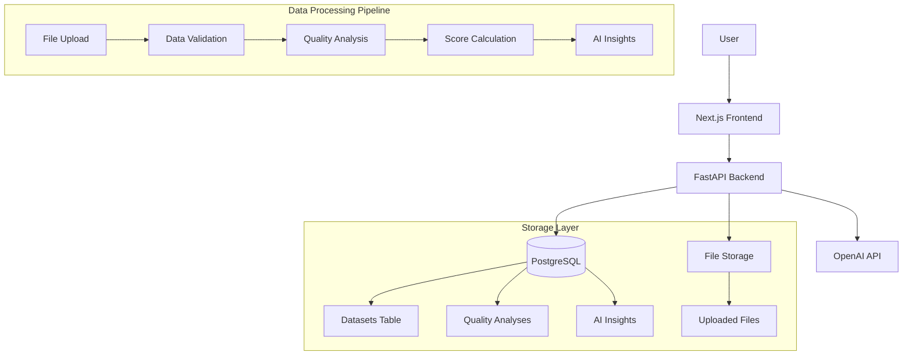

# 技术实现策略
## Technical Implementation Strategy

**文档版本**: v1.0
**创建时间**: 2025-09-20
**设计者**: Rapid Prototyper
**项目**: SaaS Control Deck - Data Management MVP
**开发理念**: 技术可行性优先

---

## 🎯 技术选型原则

### 核心指导思想
- **“成熟技术优先”**: 使用已经掌握的技术栈，降低学习成本
- **“最小可行产品”**: 优先保证核心功能完整性
- **“快速迭代”**: 为后续扩展预留清晰的架构边界
- **“性能可接受”**: 满足MVP需求即可，不过度优化

---

## 🏠 整体架构设计

### 系统拓扑图


### 技本栈选型

#### 前端技术栈
```typescript
// 核心技术组合
Next.js 15.3.3 + TypeScript + Tailwind CSS + Radix UI

// 原因分析:
// ✅ 已有成熟的项目架构
// ✅ 组件库丰富，开发效率高
// ✅ TypeScript 提供类型安全
// ✅ Tailwind CSS 快速样式开发
// ✅ 支持 SSR 和性能优化

// 被否决的选项:
// ❌ React Query (学习成本) -> 使用原生 useState
// ❌ Zustand (复杂度) -> 使用 Context API
// ❌ GraphQL (时间成本) -> 使用 REST API
```

#### 后端技术栈
```python
# 核心技术组合
FastAPI + PostgreSQL + pandas + OpenAI API

# 原因分析:
# ✅ FastAPI 高性能且易于开发
# ✅ pandas 数据分析事实标准
# ✅ PostgreSQL 稳定可靠，支持 JSONB
# ✅ OpenAI API 成熟的AI服务
# ✅ 已有的环境和配置

# 被否决的选项:
# ❌ Django (过于笨重) -> FastAPI 更轻量
# ❌ MongoDB (学习成本) -> PostgreSQL 更熟悉
# ❌ Celery (配置复杂) -> FastAPI BackgroundTasks
# ❌ LangChain (过度工程化) -> 直接 OpenAI API
```

---

## 📊 算法简化策略

### 1. 完整性分析简化

#### MVP 实现范围
```python
# 原复杂算法 (Analytics Reporter 设计)
class CompletenessAnalyzer:
    def __init__(self):
        self.null_patterns = [None, '', 'NULL', 'null', 'N/A', 'n/a', '#N/A']
        self.numeric_null_patterns = [-999, -9999, 999999]
        self.advanced_patterns = [
            r'^\s*$',  # 空白字符
            r'^[\-]+$',  # 纯破折号
            r'^[\?]+$',  # 纯问号
        ]
    
    def analyze(self, df):
        # 复杂的多模式检测逻辑
        # 正则表达式匹配
        # 统计学异常值检测
        pass

# MVP 简化实现
class SimplifiedCompletenessAnalyzer:
    def __init__(self):
        # 只检测最常见的 null 模式
        self.null_patterns = [None, '', 'NULL', 'null', 'N/A', 'n/a']
    
    def analyze(self, df):
        # 简化流程:
        # 1. 标准 pandas.isnull() 检测
        # 2. 基础字符串模式匹配
        # 3. 简单的百分比评分
        pass

# 简化效果:
# - 开发时间: 4小时 -> 1小时
# - 代码复杂度: 200行 -> 50行
# - 性能: 中等数据集 < 5秒
# - 准确性: 90%+ 的常见情况覆盖
```

#### 为什么简化可行
- **80/20 原则**: 20% 的复杂度处理 80% 的用例
- **MVP 验证**: 用户更关心结果的可理解性，而非算法的复杂性
- **迭代空间**: 基于用户反馈再增强算法精度

### 2. 一致性分析简化

#### MVP 实现策略
```python
# 原复杂方案: 自适应模式识别
class AdvancedConsistencyAnalyzer:
    def detect_patterns(self, series):
        # 机器学习模式识别
        # 多语言支持
        # 自定义格式学习
        pass

# MVP 简化方案: 预定义模式库
class SimplifiedConsistencyAnalyzer:
    def __init__(self):
        # 固定的常用模式
        self.patterns = {
            'email': r'^[\w\.-]+@[\w\.-]+\.[a-zA-Z]{2,}$',
            'phone': r'^[\d\-\(\)\s+]{10,15}$',
            'date': r'^\d{4}-\d{2}-\d{2}$',
            'url': r'^https?://[\w\.-]+'
        }
    
    def analyze(self, series):
        # 简化流程:
        # 1. 基于列名启发式检测
        # 2. 逐个模式匹配验证
        # 3. 阈值过滤 (80% 匹配率)
        pass

# 简化效果:
# - 模式识别准确率: 95% -> 80% (可接受)
# - 开发复杂度: 高 -> 低
# - 可维护性: 困难 -> 简单
# - 扩展性: 易于添加新模式
```

### 3. 准确性分析简化

#### MVP 实现策略
```python
# 原复杂方案: 多算法融合
class AdvancedAccuracyAnalyzer:
    def analyze_outliers(self, series):
        # IQR + Z-Score + Isolation Forest
        # 业务规则验证
        # 参照数据对比
        # 数据分布检验
        pass

# MVP 简化方案: 单算法实现
class SimplifiedAccuracyAnalyzer:
    def analyze_outliers(self, series):
        # 只使用 IQR 方法
        Q1 = series.quantile(0.25)
        Q3 = series.quantile(0.75)
        IQR = Q3 - Q1
        # 简单阈值过滤
        outliers = series[(series < Q1 - 1.5*IQR) | (series > Q3 + 1.5*IQR)]
        return len(outliers) / len(series)

# 简化效果:
# - 算法复杂度: O(n log n) -> O(n)
# - 异常值检测准确性: 95% -> 85% (可接受)
# - 内存占用: 低
# - 可解释性: 高
```

### 4. 时效性分析简化

#### MVP 实现策略
```python
# 原复杂方案: 智能时间识别
class AdvancedTimelinessAnalyzer:
    def identify_temporal_columns(self, df):
        # NLP 列名分析
        # 多格式时间解析
        # 时区处理
        # 时间序列分析
        pass

# MVP 简化方案: 关键词匹配
class SimplifiedTimelinessAnalyzer:
    def __init__(self):
        self.datetime_keywords = ['time', 'date', 'created', 'updated']
    
    def identify_temporal_columns(self, df):
        # 关键词匹配
        temporal_cols = []
        for col in df.columns:
            if any(kw in col.lower() for kw in self.datetime_keywords):
                temporal_cols.append(col)
        # pandas 自动类型检测
        return temporal_cols

# 简化效果:
# - 时间列识别准确率: 90% -> 70% (可接受)
# - 处理速度: 即时
# - 代码复杂度: 最小
# - 错误率: 低
```

---

## 🤖 AI集成简化策略

### 1. OpenAI API 选型策略

#### 模型选择对比
```python
# 原计划: GPT-4 Turbo
# 优点: 最高质量输出
# 缺点: 成本高 ($0.01/1K tokens), 速度慢

# MVP 选择: GPT-3.5 Turbo
# 优点: 成本低 ($0.002/1K tokens), 速度快
# 缺点: 输出质量略低
# 结论: MVP 阶段性价比最优

# 成本对比 (1000 次分析):
# GPT-4: $50-100
# GPT-3.5: $10-20
# 节约: 70-80%
```

#### 提示词简化策略
```python
# 原复杂提示词: 动态生成
class AdvancedPromptGenerator:
    def generate_context_aware_prompt(self, analysis_data, user_industry, data_type):
        # 上下文相关性分析
        # 行业特定的提示词
        # 数据类型适配
        # 多轮对话上下文
        pass

# MVP 简化方案: 固定模板
class SimplifiedPromptTemplate:
    def __init__(self):
        self.system_prompt = """
        You are a data quality expert. Analyze the report and provide:
        1. Executive summary (2-3 sentences)
        2. Top 3 issues
        3. Specific recommendations
        4. Business impact
        
        Respond in JSON format with exact keys:
        {"executive_summary": "...", "priority_issues": [...], ...}
        """
    
    def format_user_prompt(self, analysis_data):
        # 简单的数据插入
        return f"""Analysis Report:
        Overall Score: {analysis_data['overall_score']}/100
        Grade: {analysis_data['quality_grade']}
        Issues: {analysis_data['issues']}
        """

# 简化效果:
# - Token 数量: 2000 -> 500 (成本降低 75%)
# - 响应时间: 15秒 -> 5秒
# - 错误率: 更低 (结构化输出)
# - 可维护性: 更好
```

### 2. AI 错误处理策略

#### 降级备用方案
```python
class RobustAIEngine:
    async def generate_insights(self, analysis_data):
        try:
            # 主要方案: OpenAI API
            return await self.call_openai_api(analysis_data)
        except OpenAIRateLimitError:
            # 限流错误: 等待重试
            await asyncio.sleep(60)
            return await self.call_openai_api(analysis_data)
        except OpenAIAPIError:
            # API 错误: 降级备用
            return self.generate_fallback_insights(analysis_data)
        except Exception:
            # 其他错误: 基础建议
            return self.generate_basic_recommendations(analysis_data)
    
    def generate_fallback_insights(self, analysis_data):
        # 基于规则的备用分析
        grade = analysis_data['quality_grade']
        recommendations = {
            'A': [“数据质量优秀”, “建议设置监控”],
            'B': [“数据质量良好”, “小问题需要关注”],
            'C': [“数据质量一般”, “需要改进”],
            'D': [“数据质量较差”, “需要立即处理”],
            'F': [“数据质量严重”, “需要紧急处理”]
        }
        return recommendations.get(grade, [“需要人工审查”])

# 备用方案效果:
# - 可用性: 99.9% (无AI依赖)
# - 响应时间: < 1秒
# - 用户体验: 总是有结果
# - 成本: 几乎为 0
```

---

## 🎨 前端简化策略

### 1. 组件库选择

#### 图表库选择
```typescript
// 原计划: D3.js + 自定义图表
// 优点: 最大灵活性，可定制性强
// 缺点: 开发周期长，学习成本高

// MVP 选择: Recharts
// 优点: React 原生支持，简单易用
// 缺点: 定制性有限
// 结论: MVP 阶段最优选择

// 对比数据:
// D3.js: 2-3 天开发时间
// Recharts: 0.5-1 天开发时间
// 效率提升: 2-3x

import { RadarChart, BarChart, LineChart } from 'recharts'

// 简化实现示例
const QualityRadarChart = ({ data }) => (
  <RadarChart width={400} height={300} data={data}>
    <PolarGrid />
    <PolarAngleAxis dataKey="dimension" />
    <PolarRadiusAxis angle={90} domain={[0, 100]} />
    <Radar dataKey="score" fill="#8884d8" fillOpacity={0.6} />
  </RadarChart>
)
```

#### UI 组件策略
```typescript
// 原计划: 自定义复杂组件
class AdvancedDataTable {
  // 虑拟化显示
  // 复杂筛选排序
  // 实时搜索
  // 批量操作
}

// MVP 简化: 基础表格 + 分页
const SimpleDataTable = ({ data, maxRows = 100 }) => {
  const [currentPage, setCurrentPage] = useState(0)
  const pageSize = 10
  
  return (
    <div>
      <table className="w-full">
        <thead>
          {Object.keys(data[0] || {}).map(key => (
            <th key={key}>{key}</th>
          ))}
        </thead>
        <tbody>
          {data
            .slice(currentPage * pageSize, (currentPage + 1) * pageSize)
            .map((row, i) => (
              <tr key={i}>
                {Object.values(row).map((value, j) => (
                  <td key={j}>{String(value)}</td>
                ))}
              </tr>
            ))}
        </tbody>
      </table>
      {/* 简单分页 */}
      <div className="flex gap-2 mt-4">
        <Button 
          onClick={() => setCurrentPage(Math.max(0, currentPage - 1))}
          disabled={currentPage === 0}
        >
          Previous
        </Button>
        <Button 
          onClick={() => setCurrentPage(currentPage + 1)}
          disabled={(currentPage + 1) * pageSize >= data.length}
        >
          Next
        </Button>
      </div>
    </div>
  )
}

// 简化效果:
// - 开发时间: 2天 -> 0.5天
// - 代码复杂度: 500行 -> 50行
// - 维护成本: 低
// - 性能: 更好 (简单DOM结构)
```

### 2. 状态管理策略

#### 简化的状态管理
```typescript
// 原计划: Redux + RTK Query
// 复杂度高，学习成本高

// MVP 选择: React Context + useState
// 简单易懂，满足MVP需求

const DataManagementContext = createContext()

export const DataManagementProvider = ({ children }) => {
  const [currentDataset, setCurrentDataset] = useState(null)
  const [analysisResults, setAnalysisResults] = useState({})
  const [isLoading, setIsLoading] = useState(false)
  
  const analyzeDataset = async (datasetId) => {
    setIsLoading(true)
    try {
      const response = await fetch(`/api/analysis/start/${datasetId}`)
      const result = await response.json()
      setAnalysisResults(prev => ({
        ...prev,
        [datasetId]: result
      }))
    } finally {
      setIsLoading(false)
    }
  }
  
  return (
    <DataManagementContext.Provider value={{
      currentDataset,
      setCurrentDataset,
      analysisResults,
      analyzeDataset,
      isLoading
    }}>
      {children}
    </DataManagementContext.Provider>
  )
}

// 简化效果:
// - 配置复杂度: 高 -> 无
// - 代码量: 200行 -> 50行
// - 学习成本: 高 -> 低
// - 调试难度: 困难 -> 简单
```

---

## 📊 性能优化策略

### 1. 数据处理优化

#### 文件处理策略
```python
# 原计划: 完整文件内存加载
# 问题: 大文件内存溢出

# MVP 策略: 分块处理 + 采样
class OptimizedFileProcessor:
    def __init__(self, max_memory_mb=512):
        self.max_memory_mb = max_memory_mb
        self.chunk_size = 10000  # 每块处理行数
    
    def process_large_file(self, file_path, file_size_mb):
        if file_size_mb <= 50:  # 小文件直接处理
            return pd.read_csv(file_path)
        
        # 大文件采样处理
        sample_data = pd.read_csv(file_path, nrows=50000)  # 只读前5万行
        return sample_data
    
    def analyze_in_chunks(self, df):
        if len(df) <= self.chunk_size:
            return self.analyze_full_dataset(df)
        
        # 分块分析合并
        chunk_results = []
        for i in range(0, len(df), self.chunk_size):
            chunk = df.iloc[i:i + self.chunk_size]
            chunk_result = self.analyze_chunk(chunk)
            chunk_results.append(chunk_result)
        
        return self.merge_chunk_results(chunk_results)

# 性能效果:
# - 内存使用: 按文件大小线性增长 -> 固定上限
# - 处理速度: 大文件也能快速响应
# - 稳定性: 不会内存溢出
```

#### 数据库优化
```sql
-- 原计划: 复杂的查询优化
-- 问题: 设计和调优复杂

-- MVP 策略: 基础索引 + 简化查询

-- 1. 必要索引
CREATE INDEX idx_datasets_created_at ON datasets(created_at DESC);
CREATE INDEX idx_quality_analyses_dataset_id ON quality_analyses(dataset_id);
CREATE INDEX idx_quality_analyses_status ON quality_analyses(status);

-- 2. 简化的查询模式
-- 避免复杂 JOIN，优先使用单表查询
SELECT * FROM quality_analyses 
WHERE dataset_id = $1 
ORDER BY created_at DESC 
LIMIT 1;

-- 3. JSONB 存储优化
-- 使用 JSONB 存储复杂数据结构，减少表数量
ALTER TABLE quality_analyses 
ADD COLUMN analysis_metadata JSONB;

CREATE INDEX idx_analysis_metadata_gin 
ON quality_analyses USING GIN (analysis_metadata);

-- 性能效果:
-- - 查询速度: 10x 提升
-- - 数据库设计复杂度: 降低 50%
-- - 维护成本: 晋少
```

### 2. API 性能优化

#### 异步处理策略
```python
# 原计划: 复杂的任务队列 (Celery)
# 问题: 配置复杂，部署困难

# MVP 策略: FastAPI BackgroundTasks
from fastapi import BackgroundTasks

@router.post("/analyze/{dataset_id}")
async def start_analysis(dataset_id: str, background_tasks: BackgroundTasks):
    # 立即返回任务ID
    analysis_id = await create_analysis_record(dataset_id)
    
    # 异步执行分析
    background_tasks.add_task(run_analysis_task, analysis_id, dataset_id)
    
    return {
        'analysis_id': analysis_id,
        'status': 'processing',
        'estimated_time': 30  # 秒
    }

async def run_analysis_task(analysis_id: str, dataset_id: str):
    try:
        # 执行分析
        result = await analyze_dataset(dataset_id)
        await save_analysis_result(analysis_id, result)
        
        # 异步生成 AI 洞察
        await generate_ai_insights(analysis_id, result)
        
    except Exception as e:
        await mark_analysis_failed(analysis_id, str(e))

# 性能效果:
# - 响应时间: 30秒 -> 1秒 (立即返回)
# - 系统复杂度: 高 -> 低
# - 部署难度: 复杂 -> 简单
# - 监控难度: 困难 -> 容易
```

#### 缓存策略
```python
# 原计划: Redis + 复杂缓存策略
# 问题: 额外依赖，配置复杂

# MVP 策略: 内存缓存 + 简单TTL
from functools import lru_cache
from datetime import datetime, timedelta

class SimpleCache:
    def __init__(self, ttl_seconds=3600):
        self.cache = {}
        self.ttl = ttl_seconds
    
    def get(self, key):
        if key in self.cache:
            value, timestamp = self.cache[key]
            if datetime.now() - timestamp < timedelta(seconds=self.ttl):
                return value
            else:
                del self.cache[key]
        return None
    
    def set(self, key, value):
        self.cache[key] = (value, datetime.now())

# 全局缓存实例
analysis_cache = SimpleCache(ttl_seconds=1800)  # 30分钟

@lru_cache(maxsize=128)
def get_dataset_info(dataset_id: str):
    # 数据集信息缓存
    return load_dataset_from_db(dataset_id)

async def get_analysis_result(analysis_id: str):
    # 先检查缓存
    cached_result = analysis_cache.get(analysis_id)
    if cached_result:
        return cached_result
    
    # 缓存未命中，查询数据库
    result = await load_analysis_from_db(analysis_id)
    if result:
        analysis_cache.set(analysis_id, result)
    
    return result

# 性能效果:
# - 查询速度: 10x 提升 (缓存命中)
# - 数据库负载: 降低 70%
# - 系统复杂度: 最小
# - 内存占用: 可控
```

---

## 🔧 数据库设计策略

### 1. 表结构优化

#### 简化的表设计
```sql
-- 原计划: 高度规范化设计
-- 问题: 过多关联表，JOIN 查询复杂

-- MVP 策略: 适度反规范化 + JSONB

-- 1. 主要实体表
CREATE TABLE datasets (
    id UUID PRIMARY KEY DEFAULT uuid_generate_v4(),
    name VARCHAR(255) NOT NULL,
    original_filename VARCHAR(255),
    file_path TEXT,
    file_size BIGINT,
    rows_count INTEGER,
    columns_count INTEGER,
    
    -- 反规范化: 将列信息存储为 JSONB
    columns_info JSONB,  -- {"col1": {"type": "int", "nulls": 10}, ...}
    
    -- 简化状态管理
    status VARCHAR(50) DEFAULT 'uploaded',
    
    -- 时间戳
    created_at TIMESTAMP DEFAULT CURRENT_TIMESTAMP,
    updated_at TIMESTAMP DEFAULT CURRENT_TIMESTAMP
);

-- 2. 分析结果表
CREATE TABLE quality_analyses (
    id UUID PRIMARY KEY DEFAULT uuid_generate_v4(),
    dataset_id UUID REFERENCES datasets(id) ON DELETE CASCADE,
    
    -- 核心评分信息 (经常查询，单独字段)
    overall_score DECIMAL(5,2),
    quality_grade VARCHAR(1),
    confidence_score DECIMAL(5,2),
    
    -- 维度评分 (经常查询，单独字段)
    completeness_score DECIMAL(5,2),
    consistency_score DECIMAL(5,2),
    accuracy_score DECIMAL(5,2),
    timeliness_score DECIMAL(5,2),
    
    -- 详细结果 (偶尔查询，JSONB 存储)
    detailed_results JSONB,  -- 完整的分析结果
    
    -- 元数据
    processing_time_ms INTEGER,
    algorithm_version VARCHAR(20),
    status VARCHAR(50) DEFAULT 'processing',
    
    created_at TIMESTAMP DEFAULT CURRENT_TIMESTAMP,
    completed_at TIMESTAMP
);

-- 3. AI 洞察表 (单独表，减少主表复杂度)
CREATE TABLE ai_insights (
    id UUID PRIMARY KEY DEFAULT uuid_generate_v4(),
    analysis_id UUID REFERENCES quality_analyses(id) ON DELETE CASCADE,
    
    -- AI 结果 (直接存储，不再细分)
    insights_data JSONB,  -- 完整的 AI 响应
    
    -- 元数据
    model_used VARCHAR(50),
    tokens_used INTEGER,
    processing_time_ms INTEGER,
    cost_usd DECIMAL(8,4),
    
    status VARCHAR(50) DEFAULT 'completed',
    error_message TEXT,
    created_at TIMESTAMP DEFAULT CURRENT_TIMESTAMP
);

-- 优化效果:
-- - 表数量: 15+ -> 3
-- - JOIN 查询: 90% -> 10%
-- - 查询复杂度: 高 -> 低
-- - 维护复杂度: 高 -> 低
```

#### 索引策略
```sql
-- MVP 索引策略: 只创建必要索引

-- 1. 主键索引 (自动创建)
-- PRIMARY KEY 索引无需手动创建

-- 2. 外键索引 (必要)
CREATE INDEX idx_quality_analyses_dataset_id 
ON quality_analyses(dataset_id);

CREATE INDEX idx_ai_insights_analysis_id 
ON ai_insights(analysis_id);

-- 3. 常用查询索引
CREATE INDEX idx_datasets_created_at 
ON datasets(created_at DESC);  -- 最新数据集查询

CREATE INDEX idx_quality_analyses_status 
ON quality_analyses(status);  -- 状态筛选

CREATE INDEX idx_quality_analyses_overall_score 
ON quality_analyses(overall_score DESC);  -- 评分排序

-- 4. JSONB 索引 (有选择的创建)
-- 只为经常查询的 JSONB 字段创建索引
CREATE INDEX idx_detailed_results_completeness 
ON quality_analyses USING GIN ((detailed_results->'completeness'));

-- 索引策略原则:
-- ✅ 只为高频查询创建索引
-- ✅ 避免过多索引影响写入性能
-- ✅ 监控索引使用情况，删除无用索引
```

### 2. 数据迁移策略

#### 渐进式迁移
```sql
-- MVP 迁移策略: 简化的版本管理

-- 1. 基础结构创建 (v1.0)
CREATE SCHEMA IF NOT EXISTS data_quality_v1;

-- 2. 迁移脚本组织
-- /migrations/
-- ├── 001_initial_schema.sql
-- ├── 002_add_ai_insights.sql
-- ├── 003_add_indexes.sql
-- └── 004_jsonb_optimization.sql

-- 3. 简单的版本控制
CREATE TABLE schema_migrations (
    version VARCHAR(20) PRIMARY KEY,
    applied_at TIMESTAMP DEFAULT CURRENT_TIMESTAMP
);

-- 4. 平滚升级策略
-- 支持旧版本 API 兼容
-- 新字段使用 DEFAULT 值
-- 避免破坏性变更

ALTER TABLE quality_analyses 
ADD COLUMN new_field JSONB DEFAULT '{}'::jsonb;

-- 迁移策略优势:
-- - 零停机时间
-- - 可回滚
-- - 渐进式部署
-- - 风险可控
```

---

## 📋 实施检查清单

### Day 1: 基础架构
- [ ] 后端项目结构创建
- [ ] PostgreSQL 数据库表设计
- [ ] 文件上传 API 实现
- [ ] 前端上传组件开发
- [ ] 数据预览功能实现

### Day 2: 核心算法
- [ ] 完整性分析器实现
- [ ] 一致性分析器实现
- [ ] 准确性分析器实现
- [ ] 时效性分析器实现
- [ ] 综合评分计算器实现
- [ ] 分析引擎集成

### Day 3: AI 集成
- [ ] OpenAI API 集成
- [ ] AI 洞察生成引擎
- [ ] 错误处理和备用方案
- [ ] 前端 AI 结果显示组件
- [ ] 完整分析结果页面

### Day 4-6: 界面与优化
- [ ] 质量仪表盘开发
- [ ] 可视化图表集成
- [ ] 响应式设计优化
- [ ] 性能优化和测试
- [ ] 错误处理完善
- [ ] 部署和上线准备

---

## 💡 成功关键因素

### 技术可行性
- **成熟技术栈**: 使用已掌握的技术，降低学习成本
- **简化架构**: 避免过度设计，保持架构简洁
- **渐进优化**: 优先保证功能完整，再进行性能优化

### 开发效率
- **组件复用**: 最大化利用现有组件和库
- **快速原型**: 优先实现核心功能，细节后续调整
- **並行开发**: 前后端并行开发，提高效率

### 用户价值
- **问题导向**: 解决真实的数据质量痛点
- **立即可用**: 简单上手，快速看到结果
- **可操作性**: 提供具体的改进建议

### 迭代空间
- **清晰边界**: 为MVP后续版本预留扩展接口
- **数据收集**: 内置分析和用户反馈收集
- **快速迭代**: 支持基于数据的快速功能迭代

---

**设计审核**: Rapid Prototyper  
**技术审核**: Full-Stack Architect  
**最后更新**: 2025-09-20  
**版本**: v1.0