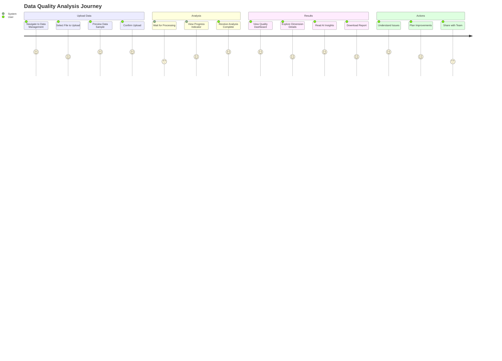
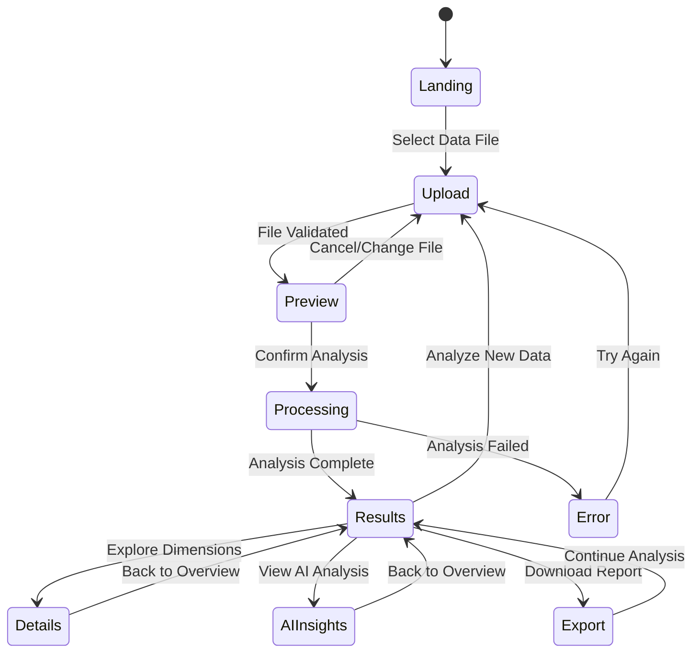

# 用户流程原型
## User Flow Prototype

**文档版本**: v1.0
**创建时间**: 2025-09-20
**设计者**: Rapid Prototyper
**项目**: SaaS Control Deck - Data Management MVP
**设计理念**: 用户体验优先

---

## 🎯 用户体验目标

### 核心用户价值
- **一键评估**: 从数据上传到质量报告，全程自动化
- **智能洞察**: AI驱动的专业分析和改进建议
- **直观理解**: 可视化显示，非技术用户也能轻松理解
- **快速响应**: 30秒内完成分析，立即查看结果

### 用户画像
- **数据分析师**: 需要快速评估数据质量，识别问题
- **业务管理者**: 关注数据质量对业务的影响
- **数据工程师**: 需要具体的数据清洗指导
- **決策者**: 关注数据可信度和风险

---

## 📱 用户流程图

### 主流程设计


### 流程状态机


---

## 📱 界面原型设计

### 1. 数据上传页面

#### 设计原则
- **清晰的操作指引**: 用户一眼就能看懂怎么操作
- **防止错误**: 文件格式验证和明确的错误提示
- **进度可见**: 上传进度条和状态反馈

#### 界面结构
```typescript
// 上传区域设计
interface UploadAreaProps {
  title: "Upload Your Data File"
  supportedFormats: ["CSV", "JSON", "Excel"]
  maxFileSize: "10MB"
  dragDropEnabled: true
  progressIndicator: true
}

// 用户界面布局
<Card className="max-w-md mx-auto">
  <CardHeader>
    <CardTitle>📁 Upload Data File</CardTitle>
    <CardDescription>
      Analyze your data quality in seconds
    </CardDescription>
  </CardHeader>
  
  <CardContent>
    {/* 拖放上传区域 */}
    <div className="border-2 border-dashed border-gray-300 rounded-lg p-8 text-center hover:border-blue-400 transition-colors">
      <Upload className="h-12 w-12 mx-auto text-gray-400 mb-4" />
      <p className="text-lg font-medium mb-2">Drag & drop your file here</p>
      <p className="text-sm text-gray-600 mb-4">or click to browse</p>
      
      {/* 支持格式提示 */}
      <div className="flex justify-center gap-2 mb-4">
        <Badge variant="outline">CSV</Badge>
        <Badge variant="outline">JSON</Badge>
        <Badge variant="outline">Excel</Badge>
      </div>
      
      <p className="text-xs text-gray-500">Maximum file size: 10MB</p>
    </div>
    
    {/* 进度条 */}
    {uploading && (
      <div className="mt-4">
        <Progress value={progress} className="w-full" />
        <p className="text-sm text-center mt-2">
          Uploading... {progress}%
        </p>
      </div>
    )}
    
    {/* 错误显示 */}
    {error && (
      <Alert className="mt-4" variant="destructive">
        <AlertTriangle className="h-4 w-4" />
        <AlertDescription>{error}</AlertDescription>
      </Alert>
    )}
  </CardContent>
</Card>
```

#### 交互行为
```typescript
// 用户交互流程
const uploadFlow = {
  // 1. 初始状态
  initial: {
    state: 'idle',
    display: '拖放或点击上传文件',
    action: 'showUploadArea'
  },
  
  // 2. 文件选择
  fileSelected: {
    state: 'validating',
    display: '正在验证文件...',
    action: 'validateFileFormat'
  },
  
  // 3. 验证成功
  validationSuccess: {
    state: 'uploading',
    display: '上传中... {progress}%',
    action: 'uploadFileWithProgress'
  },
  
  // 4. 上传完成
  uploadComplete: {
    state: 'success',
    display: '上传成功！正在跳转...',
    action: 'redirectToPreview'
  },
  
  // 5. 错误处理
  error: {
    state: 'error',
    display: '上传失败: {errorMessage}',
    action: 'showRetryButton'
  }
}
```

### 2. 数据预览页面

#### 设计原则
- **快速概览**: 在正式分析前让用户确认数据
- **关键信息突出**: 显示数据规模、类型、缺失值
- **操作确认**: 明确的“开始分析”按钮

#### 界面结构
```typescript
// 数据预览组件
interface DataPreviewProps {
  fileName: string
  fileSize: string
  rowCount: number
  columnCount: number
  sampleData: any[]
  columnTypes: Record<string, string>
  missingValues: Record<string, number>
}

<div className="space-y-6">
  {/* 文件信息卡片 */}
  <Card>
    <CardHeader>
      <CardTitle className="flex items-center gap-2">
        <FileText className="h-5 w-5" />
        {fileName}
      </CardTitle>
    </CardHeader>
    <CardContent>
      <div className="grid grid-cols-2 md:grid-cols-4 gap-4">
        <div className="text-center">
          <p className="text-2xl font-bold text-blue-600">{fileSize}</p>
          <p className="text-sm text-gray-600">File Size</p>
        </div>
        <div className="text-center">
          <p className="text-2xl font-bold text-green-600">{rowCount:toLocaleString()}</p>
          <p className="text-sm text-gray-600">Rows</p>
        </div>
        <div className="text-center">
          <p className="text-2xl font-bold text-purple-600">{columnCount}</p>
          <p className="text-sm text-gray-600">Columns</p>
        </div>
        <div className="text-center">
          <p className="text-2xl font-bold text-orange-600">{missingPercent}%</p>
          <p className="text-sm text-gray-600">Missing Data</p>
        </div>
      </div>
    </CardContent>
  </Card>
  
  {/* 数据样本表格 */}
  <Card>
    <CardHeader>
      <CardTitle>Data Preview</CardTitle>
      <CardDescription>
        Showing first 10 rows of your data
      </CardDescription>
    </CardHeader>
    <CardContent>
      <div className="overflow-x-auto">
        <table className="w-full text-sm">
          <thead>
            <tr className="border-b">
              {columns.map(col => (
                <th key={col} className="text-left p-2">
                  <div>
                    <span className="font-medium">{col}</span>
                    <div className="flex items-center gap-1 mt-1">
                      <Badge variant="outline" size="sm">
                        {columnTypes[col]}
                      </Badge>
                      {missingValues[col] > 0 && (
                        <Badge variant="destructive" size="sm">
                          {missingValues[col]} missing
                        </Badge>
                      )}
                    </div>
                  </div>
                </th>
              ))}
            </tr>
          </thead>
          <tbody>
            {sampleData.map((row, i) => (
              <tr key={i} className="border-b hover:bg-gray-50">
                {columns.map(col => (
                  <td key={col} className="p-2">
                    {row[col] ?? <span className="text-gray-400 italic">null</span>}
                  </td>
                ))}
              </tr>
            ))}
          </tbody>
        </table>
      </div>
    </CardContent>
  </Card>
  
  {/* 操作按钮 */}
  <div className="flex justify-between">
    <Button variant="outline" onClick={goBack}>
      <ArrowLeft className="h-4 w-4 mr-2" />
      Change File
    </Button>
    <Button onClick={startAnalysis} size="lg">
      <Play className="h-4 w-4 mr-2" />
      Start Quality Analysis
    </Button>
  </div>
</div>
```

### 3. 分析进度页面

#### 设计原则
- **进度透明**: 显示当前分析阶段和预估时间
- **缓解焦虑**: 通过动画和文案减少等待焦虑
- **背景处理**: 用户可以离开页面，稍后回来查看

#### 界面结构
```typescript
// 分析进度组件
interface AnalysisProgressProps {
  currentStep: string
  progress: number
  estimatedTime: number
  steps: string[]
}

<div className="max-w-2xl mx-auto text-center py-12">
  {/* 动画效果 */}
  <div className="mb-8">
    <div className="relative w-24 h-24 mx-auto mb-6">
      <div className="absolute inset-0 rounded-full border-4 border-blue-200"></div>
      <div 
        className="absolute inset-0 rounded-full border-4 border-blue-600 border-t-transparent animate-spin"
        style={{ animationDuration: '1s' }}
      ></div>
      <div className="absolute inset-0 flex items-center justify-center">
        <Brain className="h-8 w-8 text-blue-600" />
      </div>
    </div>
    
    <h2 className="text-2xl font-bold mb-2">
      Analyzing Your Data Quality
    </h2>
    <p className="text-gray-600 mb-6">
      Our AI is examining your data across 4 quality dimensions
    </p>
  </div>
  
  {/* 进度条 */}
  <div className="mb-8">
    <Progress value={progress} className="w-full h-2 mb-2" />
    <p className="text-sm text-gray-600">
      {progress}% complete • {estimatedTime} seconds remaining
    </p>
  </div>
  
  {/* 分析步骤 */}
  <div className="space-y-3">
    {steps.map((step, index) => {
      const isActive = index === currentStepIndex
      const isComplete = index < currentStepIndex
      
      return (
        <div 
          key={step} 
          className={`flex items-center justify-center gap-3 p-3 rounded-lg transition-colors ${
            isActive ? 'bg-blue-50 text-blue-700' : 
            isComplete ? 'bg-green-50 text-green-700' : 
            'bg-gray-50 text-gray-600'
          }`}
        >
          {isComplete && <CheckCircle className="h-5 w-5" />}
          {isActive && <Clock className="h-5 w-5 animate-pulse" />}
          {!isComplete && !isActive && <Circle className="h-5 w-5" />}
          <span className="font-medium">{step}</span>
        </div>
      )
    })}
  </div>
  
  {/* 背景信息 */}
  <div className="mt-12 p-4 bg-gray-50 rounded-lg">
    <h3 className="font-medium mb-2">What's happening?</h3>
    <p className="text-sm text-gray-600">
      We're analyzing your data for completeness, consistency, accuracy, and timeliness. 
      You can close this page and come back later – your analysis will continue in the background.
    </p>
  </div>
</div>

// 分析步骤定义
const analysisSteps = [
  "Loading and validating data",
  "Analyzing data completeness",
  "Checking data consistency", 
  "Detecting accuracy issues",
  "Evaluating data timeliness",
  "Calculating overall quality score",
  "Generating AI insights"
]
```

### 4. 质量仪表盘页面

#### 设计原则
- **分层信息**: 先显示概览，再提供详细信息
- **视觉层次**: 使用颜色、字号突出重要信息
- **快速导航**: Tab切换和面包屑导航

#### 界面结构
```typescript
// 仪表盘布局
<div className="space-y-6">
  {/* 概览卡片 */}
  <div className="grid grid-cols-1 md:grid-cols-4 gap-6">
    {/* 整体评分 */}
    <Card className="md:col-span-2">
      <CardContent className="p-6">
        <div className="text-center">
          <div className="text-6xl font-bold mb-2">
            <span className={getScoreColor(overallScore)}>
              {overallScore}
            </span>
            <span className="text-2xl text-gray-400">/100</span>
          </div>
          <div className="mb-4">
            <Badge 
              className={`text-lg px-4 py-1 ${getGradeColor(qualityGrade)}`}
              variant="secondary"
            >
              Grade {qualityGrade}
            </Badge>
          </div>
          <p className="text-gray-600">
            Overall Data Quality Score
          </p>
        </div>
      </CardContent>
    </Card>
    
    {/* 维度评分 */}
    <div className="grid grid-cols-2 gap-4 md:col-span-2">
      {dimensions.map(dim => (
        <Card key={dim.name}>
          <CardContent className="p-4 text-center">
            <div className={`text-2xl font-bold mb-1 ${getScoreColor(dim.score)}`}>
              {dim.score}
            </div>
            <div className="text-sm text-gray-600">
              {dim.name}
            </div>
          </CardContent>
        </Card>
      ))}
    </div>
  </div>
  
  {/* 雷达图 */}
  <Card>
    <CardHeader>
      <CardTitle>Quality Dimensions Overview</CardTitle>
    </CardHeader>
    <CardContent>
      <div className="flex justify-center">
        <RadarChart width={400} height={300} data={radarData}>
          <PolarGrid />
          <PolarAngleAxis dataKey="dimension" />
          <PolarRadiusAxis angle={90} domain={[0, 100]} />
          <Radar 
            dataKey="score" 
            stroke="#3b82f6" 
            fill="#3b82f6" 
            fillOpacity={0.3}
            strokeWidth={2}
          />
        </RadarChart>
      </div>
    </CardContent>
  </Card>
  
  {/* 关键问题提示 */}
  {criticalIssues.length > 0 && (
    <Alert>
      <AlertTriangle className="h-4 w-4" />
      <AlertTitle>Critical Issues Found</AlertTitle>
      <AlertDescription>
        <ul className="list-disc list-inside mt-2">
          {criticalIssues.slice(0, 3).map((issue, i) => (
            <li key={i}>{issue}</li>
          ))}
        </ul>
        {criticalIssues.length > 3 && (
          <p className="mt-2 text-sm">
            +{criticalIssues.length - 3} more issues. View details for complete analysis.
          </p>
        )}
      </AlertDescription>
    </Alert>
  )}
  
  {/* 快速操作 */}
  <div className="flex gap-4">
    <Button onClick={() => setActiveTab('ai-insights')}>
      <Brain className="h-4 w-4 mr-2" />
      View AI Insights
    </Button>
    <Button variant="outline" onClick={() => setActiveTab('details')}>
      <BarChart className="h-4 w-4 mr-2" />
      Detailed Analysis
    </Button>
    <Button variant="outline" onClick={exportReport}>
      <Download className="h-4 w-4 mr-2" />
      Export Report
    </Button>
  </div>
</div>

// 评分颜色函数
function getScoreColor(score: number): string {
  if (score >= 90) return 'text-green-600'
  if (score >= 80) return 'text-blue-600'
  if (score >= 70) return 'text-yellow-600'
  if (score >= 60) return 'text-orange-600'
  return 'text-red-600'
}
```

### 5. AI洞察页面

#### 设计原则
- **对话式界面**: 如同与专家对话，自然易懂
- **分段阅读**: 将内容分为摘要、问题、建议等模块
- **可操作性**: 每个建议都有明确的优先级和操作指引

#### 界面结构
```typescript
// AI洞察组件
interface AIInsightsProps {
  insights: {
    executive_summary: string
    priority_issues: string[]
    recommendations: Array<{
      issue: string
      action: string
      priority: 'high' | 'medium' | 'low'
    }>
    business_impact: string
  }
}

<div className="space-y-6">
  {/* AI摘要 */}
  <Card>
    <CardHeader>
      <CardTitle className="flex items-center gap-2">
        <Brain className="h-5 w-5 text-blue-600" />
        AI Executive Summary
      </CardTitle>
    </CardHeader>
    <CardContent>
      <div className="bg-blue-50 border-l-4 border-blue-400 p-4 rounded">
        <p className="text-gray-800 leading-relaxed">
          {insights.executive_summary}
        </p>
      </div>
    </CardContent>
  </Card>
  
  {/* 优先级问题 */}
  <Card>
    <CardHeader>
      <CardTitle className="flex items-center gap-2">
        <AlertTriangle className="h-5 w-5 text-red-600" />
        Priority Issues to Address
      </CardTitle>
    </CardHeader>
    <CardContent>
      {insights.priority_issues.length > 0 ? (
        <div className="space-y-3">
          {insights.priority_issues.map((issue, index) => (
            <div key={index} className="flex items-start gap-3 p-3 bg-red-50 rounded-lg">
              <div className="bg-red-600 text-white rounded-full w-6 h-6 flex items-center justify-center text-sm font-bold">
                {index + 1}
              </div>
              <p className="text-gray-800 flex-1">{issue}</p>
            </div>
          ))}
        </div>
      ) : (
        <div className="text-center py-8">
          <CheckCircle className="h-12 w-12 text-green-600 mx-auto mb-3" />
          <p className="text-green-800 font-medium">No critical issues identified!</p>
          <p className="text-gray-600 text-sm">Your data quality looks good overall.</p>
        </div>
      )}
    </CardContent>
  </Card>
  
  {/* 改进建议 */}
  <Card>
    <CardHeader>
      <CardTitle>Improvement Recommendations</CardTitle>
      <CardDescription>
        Specific actions to enhance your data quality
      </CardDescription>
    </CardHeader>
    <CardContent>
      <div className="space-y-4">
        {insights.recommendations.map((rec, index) => (
          <div key={index} className="border rounded-lg p-4">
            <div className="flex items-start justify-between mb-3">
              <h4 className="font-medium text-gray-900 flex-1">
                {rec.issue}
              </h4>
              <Badge 
                variant={rec.priority === 'high' ? 'destructive' : 
                        rec.priority === 'medium' ? 'default' : 'secondary'}
                className="ml-2"
              >
                {rec.priority} priority
              </Badge>
            </div>
            
            <div className="bg-gray-50 p-3 rounded border-l-4 border-blue-400">
              <p className="text-gray-700 text-sm">
                <strong>Recommended Action:</strong> {rec.action}
              </p>
            </div>
            
            <div className="mt-3 flex gap-2">
              <Button size="sm" variant="outline">
                <BookOpen className="h-3 w-3 mr-1" />
                Learn More
              </Button>
              <Button size="sm" variant="outline">
                <Copy className="h-3 w-3 mr-1" />
                Copy Action
              </Button>
            </div>
          </div>
        ))}
      </div>
    </CardContent>
  </Card>
  
  {/* 业务影响 */}
  <Card>
    <CardHeader>
      <CardTitle className="flex items-center gap-2">
        <TrendingUp className="h-5 w-5 text-purple-600" />
        Business Impact Analysis
      </CardTitle>
    </CardHeader>
    <CardContent>
      <div className="bg-purple-50 p-4 rounded-lg">
        <p className="text-gray-800 leading-relaxed">
          {insights.business_impact}
        </p>
      </div>
    </CardContent>
  </Card>
</div>
```

---

## 📧 错误处理设计

### 1. 常见错误场景

#### 文件上传错误
```typescript
// 错误类型定义
type FileUploadError = 
  | 'file_too_large'     // 文件过大
  | 'invalid_format'     // 格式不支持
  | 'corrupted_file'     // 文件损坏
  | 'network_error'      // 网络错误
  | 'server_error'       // 服务器错误

// 错误处理策略
const errorHandling = {
  file_too_large: {
    title: "File Too Large",
    message: "Please select a file smaller than 10MB",
    action: "Try compressing your file or selecting a different dataset",
    canRetry: false,
    showAlternatives: true
  },
  
  invalid_format: {
    title: "Unsupported File Format",
    message: "We currently support CSV, JSON, and Excel files",
    action: "Please convert your file to one of the supported formats",
    canRetry: false,
    showFormatGuide: true
  },
  
  network_error: {
    title: "Upload Failed", 
    message: "There was a problem uploading your file",
    action: "Please check your internet connection and try again",
    canRetry: true,
    autoRetryAfter: 5
  }
}

// 错误显示组件
const ErrorDisplay = ({ error, onRetry, onDismiss }) => (
  <Alert variant="destructive">
    <AlertTriangle className="h-4 w-4" />
    <AlertTitle>{errorHandling[error].title}</AlertTitle>
    <AlertDescription>
      <p className="mb-3">{errorHandling[error].message}</p>
      <p className="text-sm mb-4">{errorHandling[error].action}</p>
      
      <div className="flex gap-2">
        {errorHandling[error].canRetry && (
          <Button size="sm" onClick={onRetry}>
            <RefreshCw className="h-3 w-3 mr-1" />
            Try Again
          </Button>
        )}
        <Button size="sm" variant="outline" onClick={onDismiss}>
          Dismiss
        </Button>
      </div>
    </AlertDescription>
  </Alert>
)
```

#### 分析失败错误
```typescript
// 分析错误类型
type AnalysisError = 
  | 'invalid_data'       // 数据无法解析
  | 'insufficient_data'  // 数据量不足
  | 'processing_timeout' // 处理超时
  | 'ai_service_error'   // AI服务错误
  | 'system_overload'    // 系统负载过高

// 分析错误处理
const AnalysisErrorHandler = ({ error, datasetInfo, onRetry }) => {
  const errorConfig = {
    invalid_data: {
      icon: <FileX className="h-12 w-12 text-red-500" />,
      title: "Data Format Issue",
      description: "We couldn't process some parts of your data",
      suggestion: "Try cleaning your data or removing special characters",
      showDataTips: true
    },
    
    ai_service_error: {
      icon: <Brain className="h-12 w-12 text-orange-500" />,
      title: "AI Analysis Unavailable",
      description: "Basic quality analysis completed, but AI insights are temporarily unavailable",
      suggestion: "You can still view the quality scores and try AI analysis again later",
      showBasicResults: true
    }
  }
  
  return (
    <div className="text-center py-12">
      <div className="mb-6">
        {errorConfig[error].icon}
      </div>
      
      <h2 className="text-xl font-bold mb-2">
        {errorConfig[error].title}
      </h2>
      
      <p className="text-gray-600 mb-4 max-w-md mx-auto">
        {errorConfig[error].description}
      </p>
      
      <div className="bg-blue-50 p-4 rounded-lg mb-6 max-w-md mx-auto">
        <p className="text-sm text-blue-800">
          <strong>Suggestion:</strong> {errorConfig[error].suggestion}
        </p>
      </div>
      
      <div className="flex justify-center gap-3">
        <Button onClick={onRetry}>
          <RefreshCw className="h-4 w-4 mr-2" />
          Try Again
        </Button>
        
        {errorConfig[error].showBasicResults && (
          <Button variant="outline" onClick={() => showBasicResults()}>
            <BarChart className="h-4 w-4 mr-2" />
            View Basic Results
          </Button>
        )}
        
        <Button variant="outline" onClick={() => uploadNewFile()}>
          <Upload className="h-4 w-4 mr-2" />
          Upload New File
        </Button>
      </div>
    </div>
  )
}
```

### 2. 用户引导系统

#### 首次使用引导
```typescript
// 引导步骤定义
const onboardingSteps = [
  {
    target: '[data-tour="upload-area"]',
    title: "Welcome to Data Quality Analysis!",
    content: "Start by uploading your CSV, JSON, or Excel file here. We'll analyze it for quality issues.",
    placement: "bottom"
  },
  {
    target: '[data-tour="format-info"]',
    title: "Supported Formats",
    content: "We support CSV, JSON, and Excel files up to 10MB. Make sure your data has column headers.",
    placement: "top"
  },
  {
    target: '[data-tour="quality-score"]',
    title: "Quality Score",
    content: "This shows your overall data quality from 0-100, based on completeness, consistency, accuracy, and timeliness.",
    placement: "left"
  },
  {
    target: '[data-tour="ai-insights"]',
    title: "AI-Powered Insights",
    content: "Our AI analyzes your data and provides specific recommendations for improvement.",
    placement: "right"
  }
]

// 引导组件
const OnboardingTour = ({ isFirstVisit, onComplete }) => {
  const [currentStep, setCurrentStep] = useState(0)
  const [isActive, setIsActive] = useState(isFirstVisit)
  
  if (!isActive) return null
  
  return (
    <div className="fixed inset-0 z-50 bg-black bg-opacity-50">
      <div className="absolute" style={getStepPosition(currentStep)}>
        <Card className="w-80">
          <CardHeader>
            <div className="flex justify-between items-start">
              <CardTitle className="text-lg">
                {onboardingSteps[currentStep].title}
              </CardTitle>
              <Button 
                variant="ghost" 
                size="sm" 
                onClick={() => setIsActive(false)}
              >
                <X className="h-4 w-4" />
              </Button>
            </div>
          </CardHeader>
          
          <CardContent>
            <p className="text-gray-600 mb-4">
              {onboardingSteps[currentStep].content}
            </p>
            
            <div className="flex justify-between items-center">
              <span className="text-sm text-gray-500">
                {currentStep + 1} of {onboardingSteps.length}
              </span>
              
              <div className="flex gap-2">
                {currentStep > 0 && (
                  <Button 
                    variant="outline" 
                    size="sm"
                    onClick={() => setCurrentStep(currentStep - 1)}
                  >
                    Previous
                  </Button>
                )}
                
                <Button 
                  size="sm"
                  onClick={() => {
                    if (currentStep < onboardingSteps.length - 1) {
                      setCurrentStep(currentStep + 1)
                    } else {
                      setIsActive(false)
                      onComplete()
                    }
                  }}
                >
                  {currentStep < onboardingSteps.length - 1 ? 'Next' : 'Get Started'}
                </Button>
              </div>
            </div>
          </CardContent>
        </Card>
      </div>
    </div>
  )
}
```

#### 上下文帮助
```typescript
// 上下文帮助组件
const ContextualHelp = ({ context }) => {
  const helpContent = {
    'upload': {
      title: "How to Upload Data",
      tips: [
        "Ensure your file has column headers in the first row",
        "Remove any summary rows or merged cells",
        "Keep file size under 10MB for best performance",
        "CSV files should use comma separators"
      ],
      examples: [
        "Good: sales_data.csv with Date, Product, Revenue columns",
        "Avoid: Files with multiple sheets or pivot tables"
      ]
    },
    
    'quality-score': {
      title: "Understanding Quality Scores",
      tips: [
        "90-100: Excellent quality, ready for analysis",
        "80-89: Good quality with minor issues",
        "70-79: Moderate quality, some cleanup needed",
        "Below 70: Poor quality, significant issues"
      ],
      actions: [
        "Focus on the lowest-scoring dimension first",
        "Check AI insights for specific recommendations",
        "Use the detailed analysis for technical info"
      ]
    }
  }
  
  const content = helpContent[context]
  if (!content) return null
  
  return (
    <Popover>
      <PopoverTrigger asChild>
        <Button variant="ghost" size="sm">
          <HelpCircle className="h-4 w-4" />
        </Button>
      </PopoverTrigger>
      
      <PopoverContent className="w-80">
        <div className="space-y-3">
          <h4 className="font-medium">{content.title}</h4>
          
          {content.tips && (
            <div>
              <p className="text-sm font-medium text-gray-700 mb-2">Tips:</p>
              <ul className="text-sm text-gray-600 space-y-1">
                {content.tips.map((tip, i) => (
                  <li key={i} className="flex items-start gap-2">
                    <Check className="h-3 w-3 text-green-600 mt-0.5 flex-shrink-0" />
                    {tip}
                  </li>
                ))}
              </ul>
            </div>
          )}
          
          {content.examples && (
            <div>
              <p className="text-sm font-medium text-gray-700 mb-2">Examples:</p>
              <ul className="text-sm text-gray-600 space-y-1">
                {content.examples.map((example, i) => (
                  <li key={i} className="flex items-start gap-2">
                    <Info className="h-3 w-3 text-blue-600 mt-0.5 flex-shrink-0" />
                    {example}
                  </li>
                ))}
              </ul>
            </div>
          )}
        </div>
      </PopoverContent>
    </Popover>
  )
}
```

---

## 📡 响应式设计策略

### 1. 移动端优先设计

#### 断点定义
```typescript
// Tailwind CSS 响应式断点
const breakpoints = {
  sm: '640px',   // 手机横屏
  md: '768px',   // 平板竖屏  
  lg: '1024px',  // 小笔记本
  xl: '1280px',  // 桌面显示器
  '2xl': '1536px' // 大屏幕
}

// 组件响应式布局
const ResponsiveLayout = ({ children }) => (
  <div className="
    container mx-auto px-4 
    sm:px-6 
    lg:px-8
    max-w-sm sm:max-w-2xl lg:max-w-6xl
  ">
    {children}
  </div>
)

// 网格系统响应式
const QualityGrid = ({ scores }) => (
  <div className="
    grid gap-4
    grid-cols-1 
    sm:grid-cols-2 
    lg:grid-cols-4
  ">
    {scores.map(score => (
      <ScoreCard key={score.name} {...score} />
    ))}
  </div>
)
```

#### 移动端交互优化
```typescript
// 手机端菜单设计
const MobileNavigation = () => {
  const [isOpen, setIsOpen] = useState(false)
  
  return (
    <div className="lg:hidden">
      {/* 汉堡包菜单按钮 */}
      <Button 
        variant="ghost" 
        size="sm"
        onClick={() => setIsOpen(!isOpen)}
        className="p-2"
      >
        <Menu className="h-6 w-6" />
      </Button>
      
      {/* 全屏菜单 */}
      {isOpen && (
        <div className="fixed inset-0 z-50 bg-white">
          <div className="p-4">
            <div className="flex justify-between items-center mb-8">
              <h2 className="text-xl font-bold">Menu</h2>
              <Button 
                variant="ghost" 
                onClick={() => setIsOpen(false)}
              >
                <X className="h-6 w-6" />
              </Button>
            </div>
            
            <nav className="space-y-4">
              <a href="#overview" className="block py-3 text-lg border-b">
                Overview
              </a>
              <a href="#details" className="block py-3 text-lg border-b">
                Detailed Analysis
              </a>
              <a href="#ai-insights" className="block py-3 text-lg border-b">
                AI Insights
              </a>
              <a href="#export" className="block py-3 text-lg border-b">
                Export Report
              </a>
            </nav>
          </div>
        </div>
      )}
    </div>
  )
}

// 触摸优化按钮
const TouchOptimizedButton = ({ children, ...props }) => (
  <Button 
    {...props}
    className={`
      min-h-[44px] min-w-[44px]  // iOS 指导原则
      touch-manipulation        // 禁用双击缩放
      ${props.className}
    `}
  >
    {children}
  </Button>
)
```

### 2. 跨设备体验优化

#### 适配性布局
```typescript
// 数据表格响应式设计
const ResponsiveDataTable = ({ data }) => {
  const [viewMode, setViewMode] = useState('table')
  
  // 手机端使用卡片模式，桌面端使用表格模式
  const isMobile = useBreakpoint('lg') // < 1024px
  
  return (
    <div>
      {/* 桌面端表格模式 */}
      <div className="hidden lg:block">
        <table className="w-full text-sm">
          <thead>
            <tr>
              {columns.map(col => (
                <th key={col} className="text-left p-3 border-b">
                  {col}
                </th>
              ))}
            </tr>
          </thead>
          <tbody>
            {data.map((row, i) => (
              <tr key={i} className="border-b hover:bg-gray-50">
                {columns.map(col => (
                  <td key={col} className="p-3">
                    {row[col]}
                  </td>
                ))}
              </tr>
            ))}
          </tbody>
        </table>
      </div>
      
      {/* 手机端卡片模式 */}
      <div className="lg:hidden space-y-4">
        {data.map((row, i) => (
          <Card key={i}>
            <CardContent className="p-4">
              {columns.map(col => (
                <div key={col} className="flex justify-between py-2 border-b last:border-b-0">
                  <span className="font-medium text-gray-600">{col}:</span>
                  <span className="text-gray-900">{row[col]}</span>
                </div>
              ))}
            </CardContent>
          </Card>
        ))}
      </div>
    </div>
  )
}

// 自适应图表
 const ResponsiveChart = ({ data, type = 'radar' }) => {
  const containerRef = useRef(null)
  const [dimensions, setDimensions] = useState({ width: 400, height: 300 })
  
  useEffect(() => {
    const updateDimensions = () => {
      if (containerRef.current) {
        const { clientWidth } = containerRef.current
        setDimensions({
          width: Math.min(clientWidth - 40, 600),
          height: Math.min(clientWidth * 0.6, 400)
        })
      }
    }
    
    updateDimensions()
    window.addEventListener('resize', updateDimensions)
    return () => window.removeEventListener('resize', updateDimensions)
  }, [])
  
  return (
    <div ref={containerRef} className="w-full flex justify-center">
      <RadarChart 
        width={dimensions.width} 
        height={dimensions.height} 
        data={data}
      >
        {/* 图表内容 */}
      </RadarChart>
    </div>
  )
}
```

---

## 📋 用户测试计划

### 1. 可用性测试

#### 测试场景
```typescript
// 用户任务定义
const usabilityTasks = [
  {
    id: 'T001',
    name: '上传数据文件',
    description: '请上传一个CSV文件并查看数据预览',
    expectedTime: '2分钟',
    successCriteria: [
      '成功上传文件',
      '能够查看数据预览',
      '理解数据统计信息'
    ]
  },
  {
    id: 'T002', 
    name: '理解质量评分',
    description: '完成数据分析后，解释整体质量评分的含义',
    expectedTime: '3分钟',
    successCriteria: [
      '找到整体评分',
      '说出评级含义',
      '识别最差的维度'
    ]
  },
  {
    id: 'T003',
    name: '查看AI建议',
    description: '找到AI洞察并理解改进建议',
    expectedTime: '5分钟',
    successCriteria: [
      '成功打开AI洞察页面',
      '找到至少一个具体建议',
      '理解优先级含义'
    ]
  }
]

// 测试指标
const usabilityMetrics = {
  effectiveness: {
    taskCompletion: '> 90%',   // 任务完成率
    errorRate: '< 5%',         // 错误率
    helpRequests: '< 20%'      // 寻求帮助比例
  },
  efficiency: {
    taskTime: '≤ 预期时间',  // 任务完成时间
    clickPath: '≤ 5步',      // 点击路径
    backtracking: '< 10%'     // 回退操作比例
  },
  satisfaction: {
    easeOfUse: '> 4/5',       // 使用简单度
    clarity: '> 4/5',         // 界面清晰度
    usefulness: '> 4/5'       // 功能有用性
  }
}
```

### 2. A/B 测试设计

#### 界面优化测试
```typescript
// A/B 测试变量
const abTestVariants = {
  uploadInterface: {
    A: 'traditional',  // 传统按钮上传
    B: 'dragDrop'     // 拖放上传
  },
  
  scoreDisplay: {
    A: 'numeric',      // 数字显示: 85/100
    B: 'gauge'        // 仪表显示: 圆形进度条
  },
  
  navigationPattern: {
    A: 'tabs',        // Tab 切换
    B: 'wizard'       // 向导模式
  }
}

// 测试的关键指标
const abTestMetrics = {
  primary: {
    name: 'conversion_rate',
    description: '完成完整数据分析流程的用户比例',
    target: '> 80%'
  },
  
  secondary: [
    {
      name: 'time_to_first_result',
      description: '从上传到查看结果的时间',
      target: '< 2分钟'
    },
    {
      name: 'feature_discovery', 
      description: '用户发现AI洞察功能的比例',
      target: '> 70%'
    },
    {
      name: 'user_satisfaction',
      description: '用户满意度评分',
      target: '> 4.2/5'
    }
  ]
}
```

---

## 📋 总结

### 用户流程优势
- **简单直观**: 4步完成数据质量分析，无需专业知识
- **快速反馈**: 30秒内看到结果，立即获得价值
- **智能指导**: AI驱动的专业建议，降低使用门槛
- **跨设备兼容**: 手机、平板、桌面全部支持

### 设计亮点
- **错误预防**: 主动验证和清晰的错误提示
- **情境感知**: 根据数据特点调整界面和建议
- **分层信息**: 先概览再深入，满足不同用户需求
- **可操作性**: 每个问题都有具体的解决方案

### MVP 交付成果
- **可用的产品**: 6天内完成可演示的MVP
- **用户验证**: 直接获取用户反馈和使用数据
- **迭代基础**: 为后续功能建立先合的用户体验架构

---

**设计审核**: Rapid Prototyper  
**用户体验审核**: UX Designer  
**最后更新**: 2025-09-20  
**版本**: v1.0